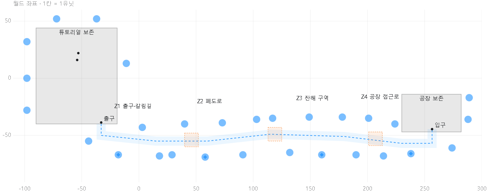
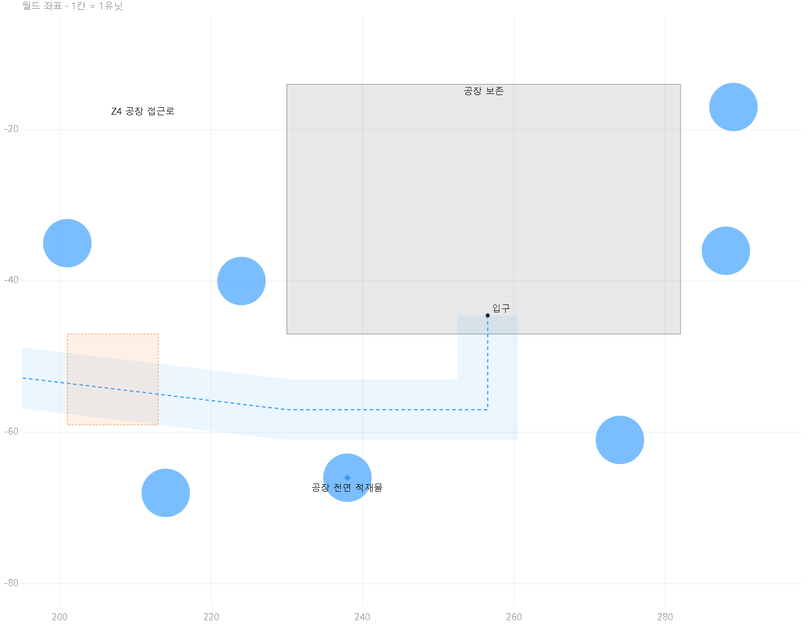
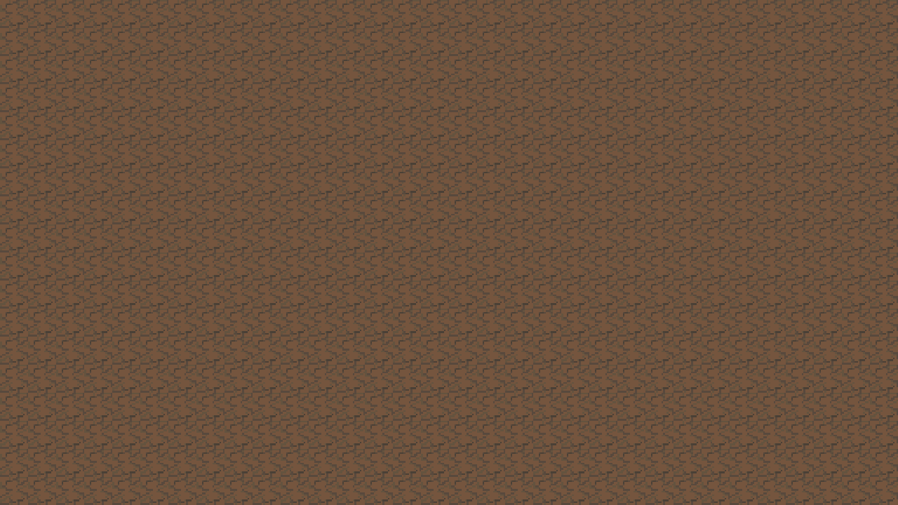
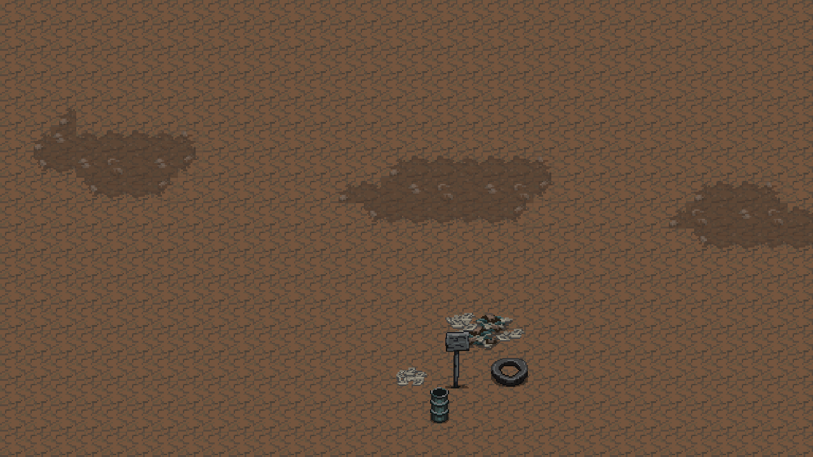
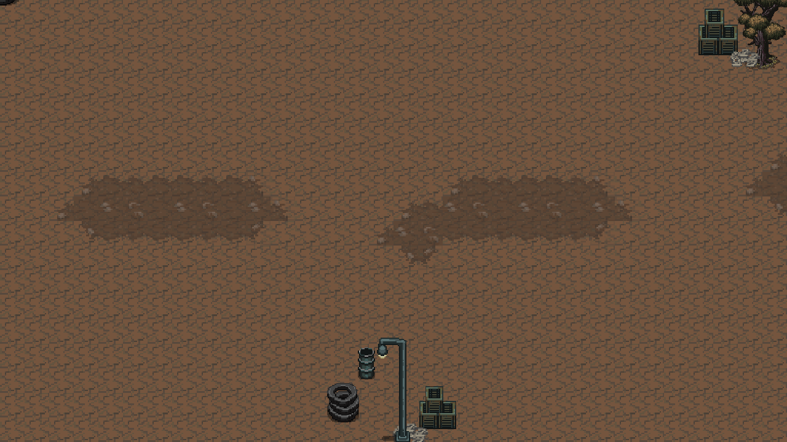
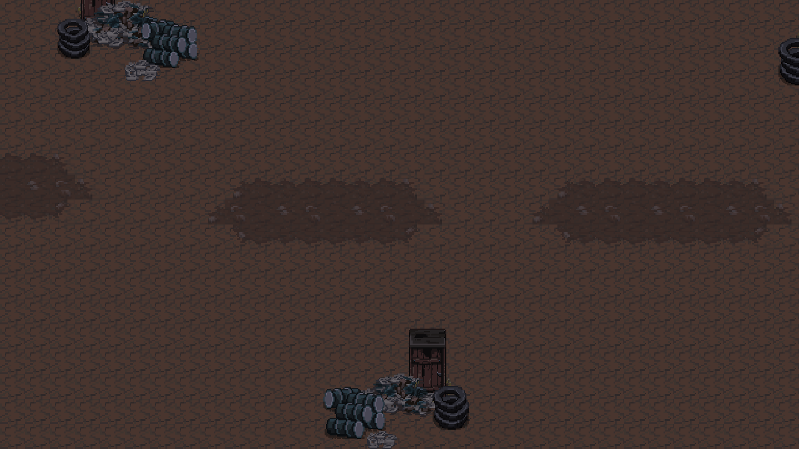

# SunNight 첫 필드 레벨디자인안 v0.1

> 2026-10-28: 새 설계는 [탐색과 강화 중심 v0.2](SunNight_레벨디자인안_v0.2.md)를 따른다. 아래 내용은 공장 직행 배치와 2026-10-26 구현의 이력이며, 현재 씬에는 아직 이 이전 배치가 남아 있다.

작성일: 2026-10-23

상태: **2026-10-26 첫 정적 배치를 TutorialScene에 반영했다.** 설계 기준은 `develop` `9c286dc2`이며, 기획은 `docs/level-design`, Unity 반영은 `feature/level-design`에서 진행했다. 아래 구역 좌표와 개념도는 최초 후보안이며, 실제 반영 위치와 검증 범위는 마지막의 **Unity 반영 현황**을 따른다.

**기존 이동 동선과 이벤트 위치를 유지하면서, 튜토리얼 출구에서 공장까지 이어지는 빈 필드에 구역별 풍경과 방향 단서를 추가한다.** 사용자가 선택한 범위는 풍경·길 찾기 보강이다. 이번 안에서는 적·자원·보상·이벤트를 늘리거나 길을 강제로 막지 않는다.

## 현재 맵이 휑하게 느껴지는 이유

실제 새 게임은 MainScene에서 TutorialScene으로 들어간다. `MapSpawner`는 빌드에 등록되지 않은 GameScene에서만 사용하므로 그쪽 맵 프리팹을 꾸며도 현재 플레이에는 나타나지 않는다.

| 확인 항목 | 현행 상태 | 디자인에 주는 의미 |
|---|---|---|
| 주필드 바닥 | 253,974개 타일 중 238,997개, 약 94.1%가 같은 스프라이트 | 이동해도 지면 변화가 작아 거리와 구역 변화가 잘 느껴지지 않음. |
| 주필드 범위 | x=-345~430, y=-301~259 | 전체를 고르게 채우기보다 실제로 지나가는 첫 구간부터 집중할 필요. |
| 시작과 출구 | 플레이어 (-53,22), 거점 (-54,16), 출구 약 (-33,-39) | 기존 튜토리얼 내부 과제와 문·스폰 공간 보존. |
| 공장 입구 | (256.53,-44.55) | 출구에서 동쪽으로 긴 빈 공간이 이어짐. |
| 자원 프리팹 | 씬의 Trashfile 11개가 주로 튜토리얼·Event1 주변에 배치 | 풍경을 채우려고 실제 채집 프리팹을 복제하면 기존 자원량이 바뀜. |
| 남쪽 이벤트 | Event1은 x=-32~-14, y=-174~-125. Event2는 x=129~182, y=-146~-105 | 기존 선택 탐색 구역으로 남기고 공장 진행의 필수 경로로 바꾸지 않음. |

타일 비율은 주필드 `/Grid/Tilemap`의 스프라이트 참조를 집계한 값이며 전체 화면 면적이나 모든 씬 오브젝트의 비율은 아니다. 큰 지도 전체의 장식 밀도를 올리는 것보다 **첫 이동 구간에서 한 화면씩 달라지는 풍경**을 만드는 편이 효과적이다.

## 배치도

다음 그림은 실제 월드 좌표를 사용한 **배치 개념도**다. 실제 게임 화면이나 충돌·길 찾기 검증 결과가 아니다. 회색은 기존 시설 보호 영역, 원은 추가 장식 군집 후보, 마름모는 그중 대표 랜드마크, 주황 사각형은 비워 둘 시야·설치 여백이다. 파란 점선은 새로 표현할 바닥 흔적의 중심선이며 강제 이동 경로가 아니다.

[확대 가능한 첫 구간 배치도](level-design/first-field-route.svg) · [남쪽 이벤트를 포함한 전체 배치도](level-design/first-field-overview.svg) · [공장 접근로 상세](level-design/factory-approach.svg)

## 공간을 채우는 네 가지 원칙

1. **바닥은 방향을, 소품은 장소의 성격을 보여 준다.** 희미한 흙길·자갈·잔해의 방향으로 공장 쪽 진행을 암시하고 가로등·폐물 더미로 기억할 지점을 만든다.
2. **소품은 묶고 군집 사이에는 여백을 둔다.** 무작위로 하나씩 흩뿌리지 않는다. 큰 물체 1개, 중간 물체 1~2개, 작은 흔적 2~4개를 한 묶음으로 시작한다.
3. **플레이 공간은 비워 둔다.** 길 중앙, 전투 진입로, 문, 상호작용 앞, 거점을 펼칠 자리에는 큰 수목·높은 소품을 놓지 않는다. 장식 때문에 화면에서 적이나 상호작용 표식이 사라지지 않게 한다.
4. **기존 황갈색 폐허 스타일을 사용한다.** PAL_SET1의 수목·가로등·타이어·드럼통·잔해를 재사용하고, 서쪽 식생에서 동쪽 산업 흔적으로 점차 바꾼다.

## 구역별 배치

### Z0 튜토리얼 외곽

- 범위: 기존 튜토리얼 x=-90~-19, y=-40~44의 **바깥 테두리**.
- 경험: 시작 장소가 주변 황무지와 구분되어 보이게 한다. 집과 학습 공간 내부에는 이미 있는 시설이 주인공이 되게 한다.
- 배치: 북쪽·서쪽 외곽에 수목 2~3종을 작은 군집으로 놓고, 낮은 잔해로 바닥과 이어 준다. 후보 중심은 (-98,32), (-98,0), (-98,-28), (-72,52), (-37,52), (-11,13)이다.
- 보존: 시작집·거점 퍼즐·방어훈련 내부, 문 앞, 스폰 위치는 그대로 둔다. 외곽 나무의 스프라이트 상단이 내부 안내를 가리지 않는지도 실제 카메라로 확인한다.

### Z1 출구와 갈림길

- 범위: 출구 아래부터 x=20 부근까지, 대략 y=-43~-72.
- 경험: 튜토리얼을 나왔다는 변화와 공장이 있는 동쪽 방향을 처음 보여 준다.
- 배치: 출구 바로 아래는 비우고, (-18,-67)에 오래된 표식과 타이어·작은 잔해를 묶는다. 바닥 흔적은 출구에서 조금 내려온 뒤 동쪽으로 완만하게 돌아간다. 남쪽 탐색 방향은 선택적으로 읽히게 두되 새 퀘스트 표식은 만들지 않는다.
- 후보 군집: (-44,-55), (-18,-67), (3,-43), (18,-68). 표식의 실제 방향 표현은 사용 가능한 스프라이트를 확인해 정한다. 방향 화살표가 없는 Sign을 그대로 쓸 경우 옆의 바닥 흔적과 소품 정렬로 유도한다.
- 보존: 출구 트리거 중심 (-32.99,-38.7), 크기 약 8.6×3.18. 통과 방향에 높은 소품·충돌체를 추가하지 않는다.

### Z2 폐도로와 식생

- 범위: x=20~105, 대략 y=-75~-32.
- 경험: 풀만 있는 빈 땅을 지나던 구간을 오래전 사람이 다니던 길로 읽게 한다.
- 배치: 양쪽 수목 군집 사이에 끊긴 흙·자갈 흔적을 놓는다. (58,-69)에 폐가로등과 낮은 가구·잔해를 묶어 작은 쉼터의 흔적을 만든다. 살아 있는 상점·보급소처럼 보이는 UI나 빛은 붙이지 않는다.
- 후보 군집: (29,-67), (40,-40), (58,-69), (73,-39), (91,-67), (103,-36). 같은 나무를 동일 간격으로 반복하지 않고 종류·군집 크기·앞뒤 위치를 바꾼다.
- 여백: (46,-54) 중심 12×12칸은 큰 소품 없이 비워 둔다. 주변 장식이 공간의 테두리를 만들게 한다.

### Z3 잔해 구역

- 범위: x=105~205, 대략 y=-75~-28.
- 경험: 공장에 가까워질수록 산업 폐기물과 사람이 남긴 흔적이 많아진다.
- 배치: 타이어·녹슨 드럼통·무너진 문짝·낮은 파편을 4~7개씩 묶는다. (160,-67)의 큰 잔해 무더기를 대표 지점으로 삼고 작은 파편 방향을 공장 쪽으로 맞춘다. 남쪽 Event2로 향할 수 있는 빈 공간은 유지한다.
- 후보 군집: (117,-35), (132,-65), (149,-34), (160,-67), (178,-34), (190,-67), (201,-35).
- 여백: (119,-49) 중심 12×12칸은 비워 둔다. 낮은 잔해를 길 전체에 깔아 플레이어·적과 배경의 경계를 흐리지 않는다.

### Z4 공장 접근로

- 범위: x=205~295의 공장 주변과 남쪽 전면.
- 경험: 흩어진 폐허에서 목적지인 공장으로 시선이 모이게 한다.
- 배치: 가로등·적재물·드럼통을 공장 앞 좌우에 모으고 입구 앞은 넓게 연다. (238,-66)을 마지막 주요 군집으로 두며 공장 정면의 기존 외형을 가리지 않는다. 수목 비중을 줄이고 단단한 직선형 소품을 늘린다.
- 후보 군집: (214,-68), (224,-40), (238,-66), (274,-61), (288,-36), (289,-17).
- 보존: 공장 보호 영역 x=230~282, y=-47~-14에는 새 군집을 넣지 않는다. 입장 중심 (256.53,-44.55)로 올라가는 전면 통로는 최소 8칸 폭의 시야를 확보한다. (207,-53) 중심 12×12칸도 큰 소품 없이 비운다.

## 길과 여백의 구체적 기준

바닥 흔적 중심선 후보는 다음과 같다. 현재 바닥이 연결된 영역을 따라 방향을 드러내는 제안이며, 벽·문·공장 위치를 이동시키지 않는다.

`(-33,-40) → (-33,-50) → (15,-55) → (60,-55) → (115,-49) → (180,-51) → (230,-57) → (256.53,-57) → (256.53,-44.55)`

| 요소 | 첫 배치 기준 | 의도 |
|---|---|---|
| 길 중앙 시야 통로 | 중심선 양쪽 합계 8칸 이상 | 플레이어·적·기존 운반 조작이 장식에 가려지지 않음. 새로운 충돌 통로를 만드는 뜻은 아님. |
| 바닥 흔적 | 폭 약 2~4칸, 패치 사이 끊김 허용 | 직선 도로처럼 강제하지 않고 진행 방향만 읽히게 함. |
| 장식 군집 | 대표 반경 약 3칸, 큰 물체는 중심선에서 더 멀리 | 지도 원은 이 후보 영역이며 정확한 개별 프리팹 위치는 다음 씬 배치 단계에서 조정. |
| 큰 랜드마크 | 출구 표식→폐쉼터→잔해→공장 적재물 | 지나온 구간을 서로 다른 모습으로 기억. |
| 중간 방향 단서 | 한두 화면 안에 바닥 변화나 다음 군집이 보이도록 | 모든 가로등을 똑같은 간격으로 찍지 않음. |
| 시야·설치 여백 | 12×12칸 후보 3곳 | 큰 물체 없이 숨을 고르고 거점을 펼칠 공간. 새 체크포인트·회복 기능을 의미하지 않음. |
| 기존 이벤트 주변 | 기존 구조와 트리거를 포함한 영역 보존 | Event1·Event2를 새 공장 필수 관문으로 바꾸지 않음. |

주 카메라는 orthographic size 9로 세로 약 18칸을 보여 준다. 16:9 화면에서는 가로 약 32칸이므로 이 크기에서 보이는 군집과 여백의 리듬을 확인한다. 화면 비율이 달라지면 별도로 검사한다.

12×12 여백은 통합 기획서의 6×6 거점 배치 기준을 고려한 후보 크기다. 현행 건설 격자는 20×12이므로 현재 가능한 최대 시설 배치 전체를 보장하지 않는다. 씬 반영 때 실제 거점·시설 배치와 함께 확인하고 필요한 방향으로 여백을 넓힌다.

중심선 길이는 약 **313칸**이다. 일반 보행 5라면 순수 이동 약 63초, 제안 운반 속도 3이라면 약 104초다. 정찰·정비·전투를 제외한 거리 환산이며 현행 운반은 아직 마우스 배치 방식이다. 통합 기획서의 이동 예산 90+120=210칸과는 다르다. **이번에는 기존 좌표 보존을 우선하며**, 실제 운반과 C3/C4 위치를 구현할 때 이동 거리·목표 시간을 다시 맞춘다. 이 시각 배치안만으로 기존 밸런스 목표를 달성했다고 보지 않는다.

## 첫 배치 수량 예산

최대 수량을 채우는 것이 목표는 아니다. 대표 군집부터 확인하고 필요할 때 늘린다. 아래 소품 수에는 군집 안의 수목·랜드마크를 포함하며 바닥 타일 수는 포함하지 않는다.

| 구역 | 군집 수 | 장식 소품 예산 | 바닥 패치 묶음 |
|---|---:|---:|---:|
| Z0 튜토리얼 외곽 | 6 | 18~24 | 0 |
| Z1 출구·갈림길 | 4 | 16~24 | 3 |
| Z2 폐도로·식생 | 6 | 24~36 | 6 |
| Z3 잔해 구역 | 7 | 28~49 | 8 |
| Z4 공장 접근로 | 6 | 24~36 | 5 |
| 합계 | **29** | **110~169** | **22** |

한 군집이 스프라이트 여러 개로 구성되므로 개체 수보다 화면을 가리는 면적을 우선 확인한다. 메인 경로 전체가 복잡해지면 소품을 더 줄이고 바닥 변화만 남긴다.

## 사용할 기존 아트

| 재료 | 현재 프로젝트 경로 | 사용 방식 |
|---|---|---|
| 표식·폐가로등 | [Sign](../Assets/Resources/Prefabs/Map/Deco/Sign.prefab), [StreetLamp](../Assets/Resources/Prefabs/Map/Deco/StreetLamp.prefab), [StreetLamp2](../Assets/Resources/Prefabs/Map/Deco/StreetLamp2.prefab) | 기존 순수 장식 프리팹. 방향 단서와 중간 높이의 실루엣. |
| 타이어·드럼통 | [Tire](../Assets/Resources/Prefabs/Map/Deco/Tire.prefab), [Tire2](../Assets/Resources/Prefabs/Map/Deco/Tire2.prefab), [DrumCan](../Assets/Resources/Prefabs/Map/Deco/DrumCan.prefab), [DrumCan5](../Assets/Resources/Prefabs/Map/Deco/DrumCan5.prefab) | 잔해 구역의 큰 묶음과 낮은 조각. |
| 적재물·파편 | [Box](../Assets/Resources/Prefabs/Map/Deco/Box.prefab), [dec_props 시트](../Assets/1.Asset/Sprite/Tile/PAL_SET1/dec_props.png) | 공장 전면과 폐쉼터. 상호작용 표시 없는 배경 소품으로 사용. |
| 수목 | [tree1](../Assets/1.Asset/Sprite/Tile/PAL_SET1/Animated/tree1.png), [tree2](../Assets/1.Asset/Sprite/Tile/PAL_SET1/Animated/tree2.png), [tree3](../Assets/1.Asset/Sprite/Tile/PAL_SET1/Animated/tree3.png) | 첫 프레임을 정적 장식으로 활용 가능. 원본이 커서 0.25~0.4배를 시작점으로 실루엣 확인. |
| 흙·자갈 | [main_lev 시트](../Assets/1.Asset/Sprite/Tile/PAL_SET1/Sliced/main_lev.png), [main_lev_217 타일](../Assets/5.TileMap/Map/main_lev_217%201.asset) | 충돌 없는 장식 전용 Tilemap에 인접 변형을 섞어 사용. |

`Map/Deco` 프리팹은 스크립트·콜라이더가 없는 장식이다. 실제 채집용 Tree·Trashfile은 풍경을 채우는 용도로 복제하지 않는다. 장식용 Box를 보급 상자처럼 강조하거나 음식·코인·약을 새로 지급하지 않는다.

## 다음 씬 반영 단계의 작업 규칙

다음은 최초 설계 때 정한 씬 반영 규칙이다. 2026-10-26 `feature/level-design`에서 이 규칙을 적용했다.

1. **전용 장식 루트 또는 프리팹을 추가한다.** 기존 TutorialScene의 대규모 타일 데이터를 재생성하지 않고 장식을 한 묶음으로 켜고 끌 수 있게 한다.
2. **현재 플레이 씬에 반영한다.** GameScene의 MapSpawner용 프리팹만 수정하는 것으로 작업을 끝내지 않는다.
3. **충돌과 건설 금지 영역은 유지한다.** 새 장식에는 Collider2D·Rigidbody2D·NavMeshObstacle·채집/피해 스크립트를 추가하지 않는다. `CantBuild`에 장식 타일을 찍지 않는다. 큰 수목은 지나갈 수 있는 길 한가운데 두지 않아 시각적 충돌 오해도 줄인다.
4. **기존 렌더 정렬을 따른다.** 현재 입체 장식은 Default sorting layer/order 1과 Y 정렬을 사용한다. 별도 Deco sorting layer는 플레이어보다 위이므로 이름만 보고 사용하지 않는다. 바닥 흔적은 지역별 바닥 렌더러 위·배우 아래에 놓는다.
5. **기존 재질을 활용한다.** 현재 소품의 Sprite-Lit 재질을 유지해 낮밤 조명에 자연스럽게 반응하게 한다. 바닥은 콜라이더 없는 전용 Tilemap에만 추가한다.
6. **보호 영역을 먼저 표시한다.** 아래 위치의 실제 Collider와 시야를 확인한 후 장식을 배치한다. 좌표는 후보이며 보호 영역에 스프라이트가 걸치면 외곽으로 옮긴다.

| 보존 지점 | 좌표·범위 |
|---|---|
| 시작집·플레이어·거점 | 집 x=-65~-43, y=11~34. 플레이어 (-53,22), 거점 (-54,16). |
| 거점 퍼즐·문 | 퍼즐 (-81.02,0.1), 문 (-69.02,-19.06), 문 폭 약 2. |
| 방어훈련 | x=-43~-24, y=-40~2. 버튼 (-26.66,-19.1). |
| 방어 스폰 4곳 | (-41.4,-3.5), (-24.5,-3.6), (-41.4,-35), (-24.2,-35.6). |
| 출구·시계 트리거 | (-32.99,-38.7), 약 8.6×3.18. |
| Event1·Event2 | 앞의 현행 영역 표 전체. 기존 문·컷신·전투·적을 유지. |
| 공장 입장 | (256.53,-44.55), 약 3.9×2.95. Player 충돌로 UI를 여는 기존 경로 보존. |

## 반영 후 확인할 기준

| 확인 상황 | 통과 기준 |
|---|---|
| 출구에서 첫 야외 화면 | 이동 가능한 중앙과 다음 시각 단서가 함께 보임. 출구·시계 안내를 가리지 않음. |
| 폐도로→잔해→공장 | 소품 구성만 보고도 구역 변화와 공장 접근을 구분할 수 있음. |
| 실제 카메라 9, 낮과 밤 | 플레이어·적·상호작용 표시가 장식에 묻히지 않음. |
| 문·퍼즐·방어훈련·공장 입구 | 기존 순서로 통과 가능하며 트리거/적 접근/진입 UI가 동일하게 작동. |
| 거점 설치와 이동 | 기존 사용 가능한 공간이 줄어들지 않고 큰 장식이 거점과 겹쳐 보이지 않음. |
| 자원·적 수 | 장식 추가 전후 실제 채집물·보상·적 구성이 동일함. |
| 변경 검토 | 기존 Transform·Collider·CantBuild·NavMesh·이벤트 참조를 유지하고 추가 장식만 구분 가능. |
| 초행 길 찾기 | 별도 새 퀘스트 화살표 없이 출구에서 공장 방향을 이해하는지 관찰. 헤매는 지점부터 바닥 흔적·표식 위치 조정. |

실제 반영은 **Z1 출구+Z4 공장 앞의 대표 군집 → Z2/Z3 연결 구간 → Z0 외곽 → 낮밤·플레이 검증** 순서가 적절하다. 먼저 양 끝의 분위기와 방향성을 확인하고 가운데 밀도를 맞춘다.

## Unity 반영 현황 — 2026-10-26

`TutorialScene`에 [FirstFieldDressing 프리팹](../Assets/LevelDesign/FirstField/FirstFieldDressing.prefab)을 루트 인스턴스로 연결했다. 기존 씬에는 연결을 위한 14줄만 추가했으며 기존 타일·Transform·Collider·이벤트 직렬화 데이터는 유지했다. 런타임 생성 스크립트 없이 저장된 배치를 그대로 사용한다.

| 구역 | 실제 군집 | 실제 소품 |
|---|---:|---:|
| Z0 튜토리얼 외곽 | 6 | 24 |
| Z1 출구·갈림길 | 4 | 20 |
| Z2 폐도로·식생 | 6 | 30 |
| Z3 잔해 구역 | 7 | 35 |
| Z4 공장 접근로 | 6 | 30 |
| 합계 | **29** | **139** |

바닥 흔적은 별도 Grid 아래 **22개 Tilemap 패치, 531칸**으로 구성했다. 중앙·테두리·모서리 타일을 섞고 투명도 0.6을 적용했다. 정렬은 바닥 Default/-9, 소품 Default/1이며 기존 Sprite-Lit 재질을 사용한다. 장식 루트의 컴포넌트는 Transform·SpriteRenderer·Grid·Tilemap·TilemapRenderer로 제한했다. 충돌체·상호작용·채집·보상·적은 추가하지 않았다.

실제 카메라 높이 18칸에 소품이 보이도록 일부 군집을 후보 지점에서 길 가장자리로 옮겼다. 개별 SpriteRenderer의 실제 bounds를 기준으로 중앙 8칸 통로와 기존 보호 영역을 피한다. 거점 후보 세 곳은 현행 건설 격자의 위쪽 오프셋까지 포함하도록 **20×14칸**의 장식 없는 여백을 확보했다. 새 체크포인트나 건설 가능 판정을 추가한 것은 아니다.

| 랜드마크 | 최초 후보 | 반영된 군집 중심 |
|---|---|---|
| 출구 표식 | (-18,-67) | (-18,-58.16) |
| 폐쉼터 흔적 | (58,-69) | (58,-61.90) |
| 잔해 무더기 | (160,-67) | (160,-57.85) |
| 공장 전면 적재물 | (238,-66) | (238,-63.49) |

모든 군집의 후보·실제 좌표는 [반영 위치 기록](level-design/implemented-placements.csv)에 있다. 원래 기획 배치도는 후보안을 설명하는 자료로 남겨 둔다.

### 화면 확인

아래는 실제 TutorialScene을 Unity Edit Mode에서 렌더링한 이미지다. 카메라 orthographic size 9, 1280×720이며 기존 낮·밤 애니메이션의 조명색을 사용했다. 플레이어·UI·전투를 실행한 게임 플레이 캡처는 아니다.

출구 주변 반영 전:

출구 주변 반영 후:

폐도로 낮 / 잔해 구역 밤:

### 검증과 유지보수

- Unity 6000.5.10f1 스크립트 컴파일·프리팹 생성·실제 씬 프리팹 로딩을 확인했다.
- 생성 단계와 실제 씬 로딩 단계에서 소품 참조, 컴포넌트 제한, 8칸 통로·보호 영역·거점 여백의 bounds 겹침, 바닥 ColliderType.None을 검사했다.
- 추가한 프리팹 연결만 제거한 씬의 기존 데이터가 기준 커밋과 동일함을 확인했다. 비교할 때 줄바꿈 형식만 정규화했다.
- 낮·밤 렌더 14장을 생성하고 확인했으며, 캡처 전후 씬 파일 SHA256도 동일하다.
- 실제 튜토리얼 완료, 운반·설치 조작, 웨이브 전투, 공장 진입까지 이어지는 Play Mode 통과 검증은 아직 수행하지 않았다. 위의 반영 후 확인 기준에 따라 플레이 점검이 필요하다.

[배치 생성 도구](../Assets/Editor/FirstFieldLevelDesign.cs)의 `SunNight > Level Design > Rebuild First Field Dressing` 메뉴로 동일한 배치를 다시 생성할 수 있다. 프리팹 수작업 변경은 재생성 시 덮어쓰므로, 배치 기준을 바꾸려면 이 도구의 후보 좌표·소품 구성·여백 기준을 먼저 수정한다. 캡처는 별도 Unity 배치 프로세스에서 [FirstFieldLevelDesignPreview.Capture](../Assets/Editor/FirstFieldLevelDesignPreview.cs)를 실행하며 `-nographics`와 `-quit`을 사용하지 않는다. 검사 로그와 전체 캡처는 Git에서 제외된 `Logs/FirstFieldPreview`에 생성된다.

## 근거와 관련 문서

- [TutorialScene 초기 위치](../Assets/3.Scripts/Scene/TutorialScene.cs#L33), [활성 빌드 씬](../ProjectSettings/EditorBuildSettings.asset#L8), [MapSpawner](../Assets/3.Scripts/MapSpawner.cs).
- [TutorialScene](../Assets/2.Scenes/TutorialScene.unity)의 Grid/Tilemap, TutorialGrid, Event1, Event2, Factory를 정적으로 확인했다. 주필드 타일 데이터는 같은 씬 약 2,602,739행, 공장 입장 Collider는 약 2,644,986행 부근이다.
- [MapManager 건설 판정](../Assets/3.Scripts/Contents/Map/MapManager.cs#L78), [기존 거점 이동](../Assets/3.Scripts/Contents/Tower/TowerMoveController.cs#L81), [카메라](../Assets/3.Scripts/Contents/Player/CameraController.cs), [정렬 레이어](../ProjectSettings/TagManager.asset).
- [통합 기획서](SunNight_통합기획서_v0.1.md), [구현 우선순위](SunNight_구현우선순위_v0.1.md).
