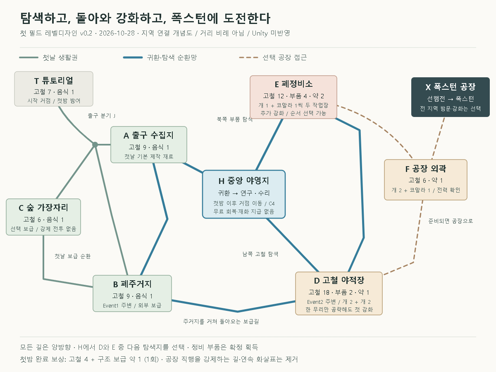
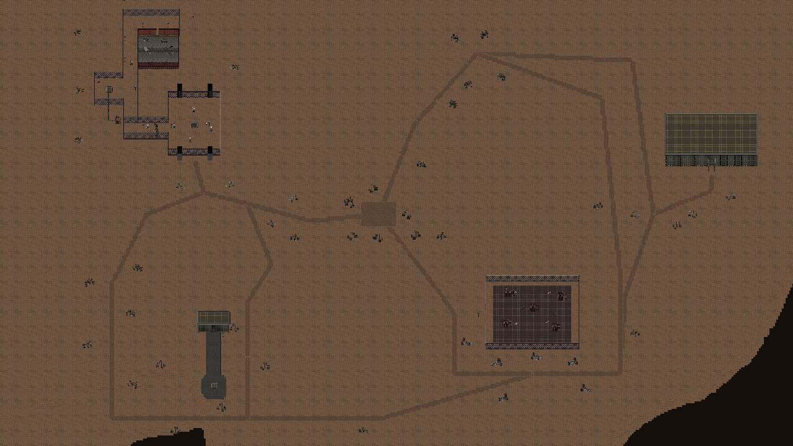
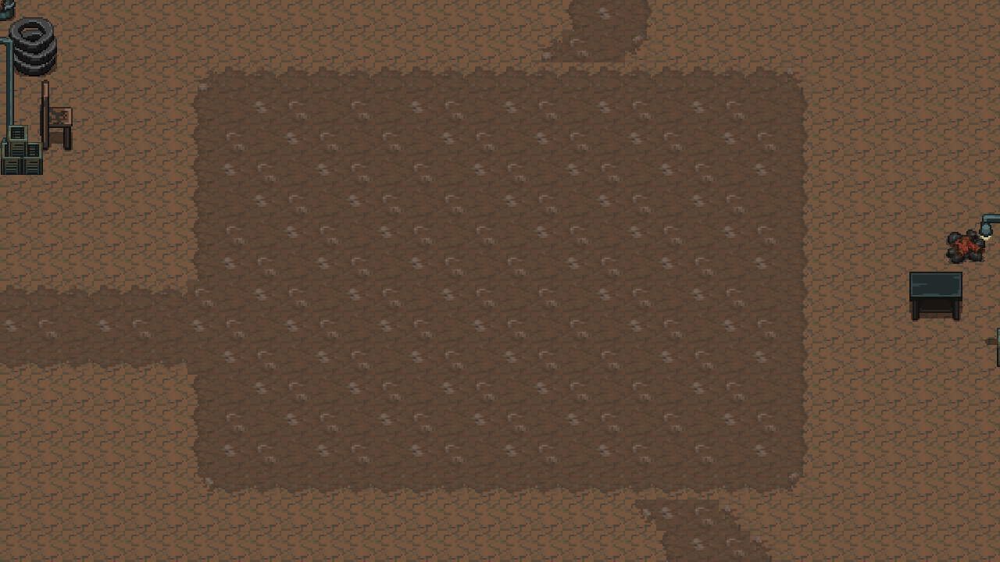

# SunNight 탐색과 강화 중심 레벨디자인안 v0.2

> 2026-10-29: 연결 길·파밍 위치·필드 몬스터 배치는 [자유 탐색 v0.3](SunNight_레벨디자인안_v0.3.md)으로 개정했다. 이 문서의 자원 총량과 연구 비용은 유지하며, 아래 배치도는 개정 전 기록이다.

작성일: 2026-10-28 · 상태: **Unity에 순환 동선·지역 보급·경비·야영지 연구·수동 저장 반영. 전체 경제·난이도 검증 전.**

첫 필드의 목적을 **여러 지역을 탐색해 재화를 모으고, 거점을 강화한 다음 폭스턴에 도전하는 것**으로 바꾼다. 공장은 시작부터 따라가는 길의 종착점이 아니라, 준비가 되었을 때 선택하는 목표다. 플레이어는 지역별 보상과 위험을 보고 다음 목적지를 정하며, 거점으로 돌아올 때마다 전력이 달라진다.

이 문서는 지역 배치·자원 공급·강화·탐색 단계·관련 체크포인트에서 [통합 기획서 v0.1](SunNight_통합기획서_v0.1.md)보다 우선한다. 변경하지 않은 조작·허기 수치·운반 조작·첫밤 구성·공장 선행전 구성·폭스턴 패턴은 통합본을 따른다. [레벨디자인 v0.1](SunNight_레벨디자인안_v0.1.md)의 공장 직행 배치와 2026-10-26 구현 이미지는 이전안의 기록이다.

## 1. 플레이 흐름

**튜토리얼 → 가까운 두 지역에서 첫밤 준비 → 야간 방어 → 중앙 야영지에 거점 이동 → 탐색·귀환·강화 반복 → 공장 외곽에서 전력 확인 → 선행전 → 폭스턴**

첫날에는 기존 제작과 방어를 익힌다. 첫밤 이후에는 시계를 둘째 날 05:30에 고정하고 허기 감소·굶주림 피해를 정지하는 기존 범위를 유지한다. 반복 야간 습격을 추가하지 않으므로 탐색 순서를 시간에 쫓기지 않고 고를 수 있다. 식량은 첫날 생존과 첫밤 이후 남은 저허기 해소에 사용하고, 이 구간에서 탐색 시간을 제한하는 연료로 삼지 않는다.

| 단계 | 플레이어의 목표 | 다음 행동을 고르는 근거 | 완료·저장 |
|---|---|---|---|
| 튜토리얼 | 고철을 모아 대포 1·벽 2 제작 | 채집이 방어력으로 바뀌는 경험 | C1, 기존 기준 유지 |
| 첫날 | 출구 수집지·폐주거지 조사 | 대포 3·벽 6과 음식 3 확보 | 480초 종료에 C2 |
| 첫밤 | 개 12·코알라 3 방어 | 자신의 배치에서 부족한 화력·내구도 확인 | 고철 4 보상 후 C3 |
| 거점 이동 | 중앙 야영지 H에 설치 | 남쪽 고철 야적장 / 북쪽 폐정비소 중 선택 | 첫 안전 설치에 C4 |
| 첫 탐색 | 외곽 보급·경비와 전투 | 정비 부품으로 어떤 강화를 살지 결정 | H 귀환·안전 정비 후 C4 갱신 |
| 추가 탐색 | 다른 지역 또는 남은 보급처 방문 | 다음 강화, 손실 복구, 회복약 비축 | C4 갱신, 획득 이력 유지 |
| 공장 접근 | 외곽 경비를 상대하고 준비 점검 | 공격·생존이 부족하면 H로 돌아감 | 안전 설치·입장 확인에 C5 |
| 폭스턴 | 준비한 장비와 회피로 첫 공장 공략 | 권장 준비 안내, 조기 도전도 허용 | 선행전 후 C6, 클리어 C7 |

전체 지역 조사·강화 횟수·부품 수는 입장 조건이 아니다. 첫밤 완료, H에 거점을 설치한 이력, 공장 발견, 입구의 현재 안전 설치만 요구한다. **첫밤을 마치고 H를 거쳐 곧바로 공장에 가는 도전도 가능**하지만, UI와 바닥 길은 탐색지를 우선 안내한다.

## 2. 수정 맵 배치도

[확대 가능한 배치도 SVG](level-design/exploration-loop-v0.2.svg)

그림은 지역의 역할과 연결을 설명하는 **비례 없는 배치 개념도**다. 아래 좌표는 Unity 반영 후보이며 충돌·실제 이동 시간 검증 전이다. 기존 튜토리얼, Event1, Event2, 공장 입구의 위치는 보존하고 주변에 탐색 구역을 구성한다. 기존 맵 전체의 빈 바닥을 모두 채우기보다 첫 플레이에 쓰이는 서쪽·북쪽·남쪽 지역을 연결한다.

| 기호·지역 | 중심 후보 / 주요 범위 | 장소의 모습과 역할 |
|---|---|---|
| T 튜토리얼 | 시작 거점 (-54,16), 출구 (-33,-39) | 기존 집·퍼즐·방어훈련 보존. 첫밤까지 거점 고정 |
| A 출구 수집지 | (-4,-64), x=-18~12 / y=-76~-50 | 낮은 철제 잔해·폐수레. 처음 얻는 추가 제작 재료 |
| B 폐주거지 | (-23,-150), x=-45~0 / y=-178~-120 | 기존 Event1 건물 주변의 식량·생활 물자. 첫날 보급은 건물 밖 |
| C 숲 가장자리 | (-80,-110), x=-105~-58 / y=-135~-85 | 수목·버려진 야영 흔적. 선택 식량과 손실 복구용 고철 |
| H 중앙 야영지 | (70,-70), x=50~90 / y=-88~-52 | 넓은 설치 공간·작업대. 수집물을 전력으로 바꾸는 귀환 거점 |
| D 고철 야적장 | (156,-125), x=125~190 / y=-155~-100 | 기존 Event2 주변 확장. 고철 다량·첫 정비 부품, 낮은 전투 위험 |
| E 폐정비소 | (125,20), x=100~150 / y=0~42 | 새 탐색지. 부품 다량·회복약, 더 강한 경비 |
| F 공장 외곽 | (224,-70), x=210~241 / y=-88~-52 | 전력 시험과 마지막 정비. 보급이 적어 주된 파밍 지역이 아님 |
| X 폭스턴 공장 | 기존 입구 (256.53,-44.55) | 기존 건물 x=230~282 / y=-47~-14 보존 |

### 연결할 길

J=(-28,-58)를 출구 아래의 분기점으로 둔다. 아래 경유점을 잇되 최종 타일 작업에서 곡률과 장애물을 조정한다. 모든 연결은 양방향이며 회수할 수 없는 일방 통행을 만들지 않는다.

| 연결 | 경유점 후보 | 역할 |
|---|---|---|
| 출구→J→A→H | (-33,-39)→J→(-4,-64)→(32,-74)→H | 출구에서 보이는 목표는 수집지와 야영지. 공장까지 이어지는 한 줄 도로 제거 |
| J→C→B→J | J→(-60,-70)→C→(-80,-145)→B→(-26,-110)→J | 서쪽 식량·생활권 순환. 첫날은 B 또는 C를 선택해 왕복 가능 |
| A→B | A→(10,-98)→(5,-140)→B | 출구 수집 후 주거지를 조사하고 다른 길로 귀환 |
| H→D→B→A→H | H→(95,-102)→D→(70,-150)→B→A→H | 남쪽 고철 수집 순환. D의 보상 구역과 통과 길은 분리 |
| H→E→D→H | H→(90,-20)→E→(195,-5)→(205,-100)→D→H | 북쪽 부품 수집과 남쪽 복귀. E→D 연결은 선택 지름길 |
| D→F, E→F | D→(208,-116)→F / E→(212,16)→F | 탐색지에서 공장 외곽을 발견하는 두 접근로 |
| F→X | F→(256.53,-57)→X | 마지막에만 공장 입구로 시선 집중 |

H에서 X까지 공장을 계속 가리키는 표지·직선 바닥 흔적은 두지 않는다. 막히지 않은 땅을 가로질러 이동하는 것은 허용한다. D·E의 보상 경비를 반드시 처치해야 F로 통과할 수 있게 만들지 않는다.

주요 길의 가시 통로는 폭 8칸, 보조 탐색 길은 폭 5~6칸을 시작값으로 둔다. H에는 현재 건설 격자를 고려해 **20×14칸 이상**의 장식 없는 공간을 남긴다. D·E 입구에도 운반 전투 전 임시 설치 공간을 두되 저장·회복 기능은 붙이지 않는다. 실제 시설 부착 규격 6×6 제안과 현행 20×12 건설 판정의 차이는 구현 단계에서 별도로 정리한다.

## 3. 지역별 확정 재화

재료는 **고철과 정비 부품 두 종류**로 제한한다. 음식·회복약은 소모품이며 강화에 쓰지 않는다. 첫 구간 코인 공급·소모는 0으로 둔다. 기존 상점·코인 강화 기능을 이 설계와 동시에 작동시키지 않는다.

| 재화 | 역할 | 구현 구분 |
|---|---|---|
| 고철 | 대포·벽 제작, 강화의 공통 비용, 시설 수리 | 기존 `IronOre` 사용 제안 |
| 정비 부품 | 탐색 전투로 얻는 희소 강화 재료 | 신규 아이템 `MaintenancePart` 구현 |
| 구운 고기 | 허기 +12, HP 회복 없음 | 기존 `Steak`, 통합본 효과 유지 |
| 회복약 | HP +20, 최대 HP 제한, 재사용 10초 | 기존 `HpPotion`, 통합본 효과 유지 |

다음 수량은 **해당 지역을 전부 조사했을 때의 총량**이다. 적 개별 드롭·무작위 상자·반복 재생성은 없고, 최초 조사·전투 보상만 계산한다.

| 지역 | 고철 | 정비 부품 | 음식 | 회복약 | 획득 방법 |
|---|---:|---:|---:|---:|---|
| T 튜토리얼 | 7 | 0 | 1 | 0 | 고철 3·2·2, 음식 1. 고철 7은 학습 제작에 전부 사용 |
| A 출구 수집지 | 9 | 0 | 1 | 0 | 고철 3개짜리 지점 3곳, 음식 상자 1곳. 강제 전투 없음 |
| B 폐주거지 | 9 | 0 | 1 | 0 | 건물 밖 고철 3개짜리 지점 3곳, 식량 상자 1곳. Event1 퍼즐은 지급 조건 아님 |
| C 숲 가장자리 | 6 | 0 | 1 | 0 | 고철 3개짜리 지점 2곳, 음식 상자 1곳. 시간·거리 부담이 있는 선택 보급 |
| D 고철 야적장 | 18 | 2 | 0 | 1 | 입구 안전 수집 6. 경비 무리 2개를 각각 처리하면 고철 6·부품 1씩, 마지막 무리에 약 1 |
| E 폐정비소 | 12 | 4 | 0 | 2 | 입구 안전 수집 4. 작업장 두 곳에서 각각 고철 4·부품 2·약 1 |
| F 공장 외곽 | 6 | 0 | 0 | 1 | 경비 처리 후 고철 3개짜리 지점 2곳, 약 1. 공장 진입 전에 수령 |
| 첫밤 완료·C3 보급 | 4 | 0 | 0 | 1 | 고철 4 완료 보상, 회복약 1은 C3에서 최초 한 번 수령하는 구조 보급 |
| 전 구역 합계 | **71** | **6** | **4** | **5** | 튜토리얼 소비 전의 누적 공급 |

첫날 기본 합계 T+A+B는 **고철 25·음식 3**, C까지 포함하면 **고철 31·음식 4**로 기존 예산을 유지한다. 첫밤 보상·약은 낮 예산에 넣지 않는다. 기존 통합본의 이동 중 고철 6·음식 1·약 3을 위 표에 중복 추가하지 않는다. 이동 보급은 이 지역별 공급표로 전부 대체한다.

31고철은 첫날 생활권의 공급량이며 맵 전체의 첫날 획득 상한은 아니다. D·E의 조기 탐색을 투명벽이나 날짜 잠금으로 막지 않는다. 첫날에도 위험을 감수하고 경비를 공략하면 같은 보상을 받을 수 있지만, 거점 운반·연구·수리는 첫밤 완료 전까지 잠긴다. 조기에 받은 보상은 다음 날 다시 지급하지 않는다.

필드 상자는 4초 조사 후 지급한다. 취소 시 진행은 초기화하며 지급하지 않는다. 가방이 가득 차면 미수령분만 상자에 남긴다. D·E의 전투 보상은 각 무리의 예정 생성·전멸을 확인한 뒤 별도 상자에서 수령하며, 부품을 확률 드롭으로 만들지 않는다. 첫밤 완료 보상 외의 보상은 자동 인벤토리 지급하지 않는다.

## 4. 지역 전투와 첫 강화

| 지역 | 전투 구성 | 배치·보상 규칙 | 기대 경험 |
|---|---|---|---|
| A·B·C | 필수 보급 동선의 강제 전투 0 | 기존 이야기 이벤트는 별도 선택이며 보급을 잠그지 않음 | 첫날 제작 자원을 안정적으로 확보 |
| D | 개 2 + 개 2, 두 무리 | 무리 간 추적 범위를 분리. 각 무리를 처리하면 고철 6·부품 1. 총 HP 120 | 첫밤의 대포 3·벽 6으로 공략 가능. 한 무리만 마치고 귀환해도 부품 1 확보 |
| E | 개 1·코알라 1씩 두 작업장 | 각 작업장에 고철 4·부품 2·약 1. 총 HP 210 | 강화 없이도 도전 가능하나 첫 강화 후 위험 감소 |
| F | 개 2·코알라 1 | 넓은 설치 공간 앞에서 경비를 보여 줌. 총 HP 135 | 강화한 전력의 확인. 부담되면 공장 입장 전 귀환 |

필드 경비는 거점에서 충분히 떨어진 지정 구역에 고정한다. 거점 H와 첫날 길에는 배회하지 않는다. 추적 반경 시작값은 12칸이며, 전투 구역 이탈 시 복귀·HP 원상 복구로 경계 왕복 공격을 통한 무위험 파밍을 막는다. 완전히 처치한 개체와 받은 보상은 계속 유지한다. 복귀로 보상 상자가 다시 잠기거나 이미 처치한 적이 재생성되지 않는다.

권장 첫 탐색은 D이지만 E를 먼저 골라도 된다. D 한 무리의 부품 1로 배트를 강화할 수 있고, D 전체의 부품 2로 대포 연구를 먼저 살 수도 있다. 특정 지역의 고유 열쇠를 강화나 입장에 요구하지 않는다.

## 5. 강화 항목과 비용

**첫밤 완료 후 설치된 거점의 작업대에서 연구를 해금한다.** 시작 거점, H, 공장 준비 구역에서 동일한 연구 상태를 사용한다. 지역을 옮겨도 다시 구매하지 않는다. 첫 구간에는 각 연구를 1회만 구매하며 상위 단계는 없다.

| ID | 강화 | 고철 | 부품 | 효과 | 선택 이유 |
|---|---|---:|---:|---|---|
| U1 | 배트 보강 I | 6 | 1 | 배트 피해 6→9. 공격 간격·범위 동일 | 직접 전투를 적극적으로 하는 선택 |
| U2 | 대포 포신 I | 8 | 2 | 모든 대포 피해 5→7. 간격 1.5초·사거리 8 유지 | 포탑 중심 화력 강화 |
| U3 | 방어판 I | 6 | 1 | 대포 최대 HP 20→30, 벽 최대 HP 30→45 | 탐색 전투·선행전 손실 감소 |
| U4 | 거점 프레임 I | 8 | 2 | 거점 최대 HP 500→650, 동시 작동 대포 3→4개 | 안정성과 추가 포탑 운용. 네 번째 대포 제작비는 별도 |
| 전체 연구 | 4종 모두 | **28** | **6** | 부품 전량 소비 | 필수 조건이 아닌 완전 탐색 보상 |

U2~U4는 연구 해금 상태로 저장하고 현재·회수 중·새로 제작하는 해당 시설에 공통 적용한다. 개별 시설 파괴로 연구는 사라지지 않는다. 최대 HP 증가는 **현재 HP를 회복하지 않는다**. 예를 들어 HP 12/20 대포는 U3 후 12/30이며, 추가 회복은 수리로 한다. 신규 제작 시설만 연구가 반영된 최대 HP로 생성한다. 시설 교체·회수·운반으로 공격 대기시간이 초기화되지 않는다.

첫 구간에서는 플레이어 소유의 동시에 작동하는 대포를 **기본 3개, U4 이후 4개**로 제한한다. 거점 부착·독립 설치를 합산하므로 여러 곳에 나누어 놓아도 상한을 우회하지 못한다. 기존 통합본의 무제한 대포 증설 제안을 이 규칙으로 바꾼다. 고철을 전부 값싼 대포 수에만 투자해 탐색·강화 선택을 건너뛰는 것을 줄이기 위한 제한이다. 소유한 여분은 보관할 수 있지만 슬롯 초과 배치는 허용하지 않고, 배치 전에 현재/최대 수를 안내한다. 운반을 시작할 때 부착 대포 슬롯은 예약해 두고 재설치 때 되돌리며, 포장 상태를 이용해 상한을 넘겨 배치하지 못한다. 벽은 별도 수량 상한 대신 거점 부착 영역과 회피 경로 검사를 따른다.

### 제작·수리

| 행동 | 비용 | 결과 | 소요 시간 |
|---|---|---|---|
| 대포 제작 | 고철 5 | 대포 1개, 연구 반영 | 즉시 |
| 벽 제작 | 고철 1 | 벽 1개, 연구 반영 | 즉시 |
| 대포 수리 | 고철 1 | 선택 대포 HP +10, 최대 HP까지 | 3초 |
| 벽 수리 | 고철 1 | 선택 벽 HP +15, 최대 HP까지 | 3초 |
| 거점 수리 | 고철 1 | 거점 HP +50, 최대 HP까지 | 3초 |
| 강화 연구 | 위 표 | 해당 연구 영구 해금, 현재 시도 내 유지 | 3초 |

수리·연구는 첫밤 이후, 설치 상태·플레이어 2칸 이내·추적 적 0·주변 12칸 이내 적 0일 때만 가능하다. 시작 시 비용을 예약하고 완료 시 원자적으로 차감한다. 피격·이동·운반·취소 시 효과 없이 예약을 해제한다. 최대 HP인 대상은 수리 버튼을 막고, 초과 회복분은 버린다. 본체전 중 수리·연구는 금지한다. 시설 수리와 약의 플레이어 회복을 혼동하지 않도록 별도 표시한다.

## 6. 실제로 성립하는 자원 예산

첫밤 권장 시설은 대포 3·벽 6이며 제작비 합계는 **21고철**이다. 기본 수집 25에서 제작 후 4, 첫밤 보상 4를 받아 C3 고철은 **8**이다. 아래 계산은 추가 시설 파괴·소비가 없는 출발 예산이며, 음식·회복약은 강화비에 포함하지 않는다.

| 선택 | 방문·연구 | 누적 공급 | 제작·연구 소비 | 수리 등에 남는 고철 |
|---|---|---|---|---:|
| 조기 도전 | T+A+B+첫밤+F, 연구 없음 | 고철 35 / 부품 0 | 제작 21 | 14 |
| 한 지역 탐색 | 위 경로+D, U1+U3 | 고철 53 / 부품 2 | 제작 21 + 연구 12 | 20 |
| 권장 탐색 | T+A+B+첫밤+D+E+F, U1+U2+U3 | 고철 65 / 부품 6 | 제작 21 + 연구 20 | 24, 부품 2 보유 |
| 완전 탐색 | C 포함 전 지역, U1~U4 + 대포 1 추가 | 고철 71 / 부품 6 | 최초 제작 21 + 연구 28 + 추가 대포 5 | 17 |

권장 경로에서는 **F 도착 전** 고철이 59 공급된다. 최초 시설 21·연구 20을 빼면 18이고, 수리 예산 12를 남겨도 6이 남는다. 마지막 F 보급 없이 권장 강화를 끝낼 수 있으므로 공장 앞에서 강화 재료를 받아 다시 멀리 돌아가는 것을 강요하지 않는다. F의 고철 6은 입장 직전 정비 여유다.

수리 예산 12의 예: U3 후 거점 400/500은 고철 2, 대포 3개가 각각 20/30이면 3, 벽 6개가 각각 30/45이면 6으로 **고철 11**을 써서 전부 회복하고 1을 남긴다. 이 예보다 피해·파괴가 크면 더 많은 고철이 필요하다. 완전 탐색 후에도 고철 17이 남지만 모든 최악의 손실을 보장하지 않는다.

U4를 먼저 고르면 고철 8·부품 2 외에 네 번째 대포 고철 5가 필요하다. 반대로 D에서 얻은 부품 2를 U2 하나에 쓰면 U1·U3은 E를 더 조사하기 전까지 살 수 없다. 강화 환불·부품 분해·상점 구매는 첫 구간에 제공하지 않는다. 선택을 바꾸려면 재도전용 이전 준비 스냅샷을 복원한다.

## 7. 폭스턴에서 느껴지는 성장

폭스턴은 HP 1,100, 기존 A/B/C 패턴·전조·노출 6초를 유지한다. 강화 여부에 따라 보스 HP를 올리지 않는다. 본체전의 레이저는 기존안대로 시설에 직접 피해를 주지 않으므로 U3·U4의 내구도는 주로 필드·첫 공장 선행전에서 효과를 낸다. U4의 대포 슬롯과 U1·U2의 피해는 본체전에도 유효하다.

통합본과 같은 가정으로 38초 동안 대포는 개당 12발, 배트는 12회 명중한다고 놓는다. 아래 시간은 `1100×38÷주기 피해`로 계산하며 접근·회피 손실·치유·시작 안내를 제외한 비교다.

| 준비 | 38초당 피해 | 단순 처치 환산 | 실제 플레이 목표 |
|---|---:|---:|---|
| 대포 3, 연구 없음 | 3×12×5 + 12×6 = 252 | 약 166초 | 170~230초 |
| 대포 3, U1+U3 | 3×12×5 + 12×9 = 288 | 약 145초 | 155~210초 |
| 대포 3, U1+U2+U3 | 3×12×7 + 12×9 = 360 | 약 116초 | 130~180초 |
| 대포 4, U1~U4 | 4×12×7 + 12×9 = 444 | 약 94초 | 110~150초 |

권장 준비는 작동 대포 3, U1·U2·U3, 플레이어 HP 80 이상·회복약 2개 이상이다. **권장 상태이지 입장 잠금이 아니다.** 음식은 허기를 확인해 사용하고, 허기 감속이 남았다면 입장 전에 해소하도록 안내한다. 약 5개 전부를 보스까지 보존한다고 가정하지 않는다. 권장 경로에서 얻는 약 5개 중 탐색·선행전에 3개를 써도 2개를 남길 수 있다는 예산이다.

F 경비에서 포탑이 빠르게 파괴되면 수리·U3, 시간이 오래 걸리면 U1·U2를 안내한다. 수치에 따라 자동 입장을 막지는 않는다. 공장 선행전의 구성 개 7·코알라 2와 보스 패턴은 유지하되, 강화된 권장 상태의 선행전 목표는 50~80초로 재측정한다.

## 8. 귀환·실패·저장

H는 연구와 정비를 위한 중심이지 무료 회복소가 아니다. 설치·귀환·체크포인트 갱신으로 HP·허기·시설 내구도를 채우지 않는다. 첫밤 이후에는 거점을 H에 두고 도보로 탐색하는 것을 기본으로 안내하되, 임시 설치 장소로 운반하는 선택도 허용한다.

| 저장 | 저장 시점 | 실패·선택 복귀 |
|---|---|---|
| C3 | 첫밤 보상 처리 직후, 구조 보급 약은 미수령 | 첫 H 설치 전 실패. 첫 탐색 준비를 다시 하고 싶으면 별도 보존한 C3 선택 |
| C4 | H 최초 안전 설치, 이후 H 안전 귀환·정비 확인 시 갱신 | 탐색 중 사망·거점 파괴 시 마지막 C4. 마지막 출발 이후 획득·소비·처치·강화 전체 되돌림 |
| C5 | F 안전 설치 후 공장 입장 확인 | 선행전 실패 또는 보스에서 외부 재준비 선택 |
| C6 | 선행전 완료·정비·도전 확인 | 보스 재도전, 해당 시점 약·시설·연구 복원 |
| C7 | 클리어 확정 | 결과 상태 유지 |

안전 저장은 거점 설치 완료·플레이어와 거점 생존·추적 적 0·주변 12칸 적 0을 요구한다. H의 연구·수리 완료 후에는 같은 상태를 C4에 원자적으로 갱신한다. D·E의 상자를 여는 행동 자체는 체크포인트가 아니다. 탐색으로 얻은 것을 보존하려면 H로 귀환한다.

C5 이후 외부 재준비를 선택하면 C5 전체를 복원한 후 필드로 나간다. 이때 이전 C6을 무효화한다. H에 귀환하면 C4를 새로 저장하고 활성 복귀 지점도 C4로 바꾼다. 다시 F에서 입장할 때 C5를 갱신하고 선행전은 재시작한다. 과거 C3를 선택하면 이후 C4~C6을 무효화한다. 각 스냅샷에는 인벤토리·연구 4종·대포 슬롯·개별 HP·현재 HP 상한·상자 잔량·처치 이력·보상 수령·날짜·허기를 함께 넣는다.

유한 보급을 모두 소비해 복구가 어려우면 보존한 C3에서 탐색을 다시 시작하거나 C1에서 첫날부터 재준비할 수 있다. 최신 연구나 인벤토리를 과거 월드에 가져가지는 못한다. 첫밤 보상, 부분 수령, 사망, 재입장으로 재화가 늘어나는 경로를 허용하지 않는다.

## 9. 풍경과 길 찾기 변경

기존 장식 139개를 새 의미에 맞춰 재사용하되 수량을 목표로 삼지 않는다. v0.1의 동서 직선 흙길 22패치는 배치 기준에서 제외하고, 새 순환 길을 먼저 회색 블록과 임시 표식으로 검증한다. 이전 장식 프리팹과 새 배치를 동시에 켜 놓지 않는다.

- 출구 화면에는 A의 잔해와 B·C로 향하는 분기만 읽히게 한다. 먼 공장까지 반복되는 가로등 줄을 없앤다.
- B는 지붕·담장·생활 잔해, C는 수목과 야영 흔적, D는 높은 고철 더미, E는 기계·작업대·정비 표식으로 구분한다.
- H는 빈 설치 공간과 작업대가 눈에 띄는 곳으로 만들고, 북쪽 E·남쪽 D 방향을 한 화면에서 고를 수 있게 한다.
- 실제 수집 지점은 상호작용 표시와 사용 후 외형 변화를 갖는다. 일반 장식 Box·드럼통에는 보상 표시를 붙이지 않는다.
- 탐색지는 입구에서 보상 구역과 적을 미리 볼 수 있게 한다. 먼 랜드마크와 가까운 바닥 흔적을 함께 쓰되 지속적인 공장 목적지 화살표는 표시하지 않는다.
- 공장 실루엣은 D·E의 외곽에서 발견하도록 하고, F 이후에만 공장 문을 향한 방향성을 강하게 만든다.

## 10. 검증 기준과 구현 순서

| 검증 | 통과 기준 |
|---|---|
| 첫날 | A 왕복·조사 95초, B 160초, 제작·배치 60초를 시작 목표로 삼음. 기본 준비 315초, 선택 C 100초를 더해 415초로 435초 경고 전 완료. 실제 첫 출구 통과와 읽기 시간 포함 재측정 |
| 탐색 선택 | H에서 D·E의 위험과 주 보상을 읽고 자유롭게 순서를 고를 수 있음. 한 지역 탐색만으로도 의미 있는 연구 구매 가능 |
| 귀환 리듬 | H→D→H 약 3~4분, H→E→H 약 4~5분(전투·조사 포함). 전투 없는 연결 길에서 30초 이상 연속으로 볼거리·갈림길 없는 이동이 생기지 않음 |
| 준비 시간 | 첫밤 이후 H 이동·권장 두 지역 탐색·강화·F 접근까지 약 10~14분 목표. 튜토리얼·첫날·보스 시간과 구분해 측정 |
| 예산 | 공급 71/6/4/5, 기본 첫밤 잔고 8, 권장 연구 20/4, 전체 연구 28/6이 실제 수령·소비 로그와 일치 |
| 선택의 효과 | 무강화보다 권장 강화의 보스전이 짧고, U3 적용 시 필드·선행전 시설 파괴가 줄어듦. 보스 자동 스케일링 없음 |
| 조기 도전 | C·D·E 미완료, 연구 0회여도 필수 진행·안전 조건만 충족하면 공장 진입 가능 |
| 보존·복원 | 원래 튜토리얼·Event1·Event2 참조와 공장 진입 기능을 유지. 고갈·연구·소비·처치를 같은 시점으로 복원 |

구현은 **새 순환 동선 블록아웃 → 실제 재화 지점과 수령 상태 → 연구·수리와 저장 → 경비 전투 → 조기/권장/완전 탐색 플레이 비교 → 최종 장식** 순서로 진행한다. 현행 코인 기반 시설 업그레이드 UI와 신규 연구 규칙의 연결, 디버그 코인 지급, 기존 적 드롭·재생성은 별도 수정이 필요하다. 이 문서의 신규 재화·연구·안전 저장은 현재 코드에 이미 구현됐다는 의미가 아니다.

## 11. 이전 통합안과 달라지는 범위

| 항목 | v0.1 | 이번 기준 |
|---|---|---|
| 필드 목적 | 첫 방어 후 공장까지 이동 | 지역 선택·귀환·강화의 반복 |
| 길 | 출구→공장 약 313칸 장식 길 | 서쪽 생활권·남쪽 야적장·북쪽 정비소의 순환망. 210칸 운반 예산도 폐기하고 연결별 실측 |
| 공급 | 첫날 최대 31 + 첫밤 4 + 이동 6 | 첫 구간 전체 고철 71·부품 6·음식 4·약 5, 지역 공급표 우선 |
| 강화·수리 | 첫 구간 제외 | 첫밤 이후 연구 4종·유료 수리 |
| 대포 수 | 입장·설치 수량 상한 없음 | 기본 작동 3, U4 이후 4. 입장 권장 수와 별개 |
| C4 | 이동 중 지정 장소 최초 저장 | H 최초 설치 후 안전 귀환·정비 때 갱신 |
| 폭스턴 | 표준 150~210초 | HP·패턴 유지, 준비별 170~230 / 155~210 / 130~180 / 110~150초로 비교 |
| 유지 | 기본 전투·운반·첫밤·선행전 패턴 | 고철 제작비 5/1, 첫날 480초, 첫밤 개 12·코알라 3, 운반 3·설치 3초, 보스 HP 1,100과 A/B/C 유지 |

기존 [구현 우선순위 v0.1](SunNight_구현우선순위_v0.1.md)은 개정 전 기준이다. 다음 구현 백로그에서는 자원·연구·귀환 저장을 공장 직행 연출보다 앞에 두고 이 변경표를 반영한다.

## 12. Unity 1차 반영 — 중앙 야영지와 순환 탐색망 (2026-10-28)

`feature/level-design`에서 `TutorialScene`의 `FirstFieldDressing` 프리팹을 v0.2 배치로 교체했다. 이전 직행안의 장식과 길을 중복 배치하지 않는다. 튜토리얼·Event1·Event2·공장 원본 오브젝트와 기존 참조는 유지한다.

### 실제 배치와 기획 좌표의 차이

| 지역 | 이번 배치 | 조정 이유 |
|---|---|---|
| H 중앙 야영지 | (70, -70), 중앙 20×14칸 바닥과 빈 설치 공간, 좌우 작업대·상자·조명 | 세 방향 길이 모이고 다시 출발하는 시각적 중심 |
| A 출구 수집지 | (-4, -64) | 출구에서 H 또는 B로 갈라지는 지점 |
| B 폐주거지 | 외부 탐색 기준점 (-4, -150) | 제안 (-23, -150)은 기존 Event1 건물 내부. 동쪽 골목으로 이동하고 C 연결은 남쪽 y=-185로 우회 |
| C 숲 가장자리 | (-80, -110) | 나무·야영 흔적, J와 B를 연결하는 서쪽 루프 |
| D 고철장 | 외부 설치 기준점 (156, -160), 20×14칸 확보 | 제안 (156, -125)은 Event2 내부. 기존 전투 구역 남쪽으로 길과 임시 설치 공간을 분리 |
| E 작업장 | (125, 20), 20×14칸 확보 | 책상·보관함·부품 더미를 둘러 배치, H/D/F 선택 가능 |
| F 공장 외곽 | (224, -70) | D/E에서 모여 공장 문으로 향하는 마지막 접근부 |

이 표는 이번 **외부 길·장식의 실제 배치 기준**이다. 보상·적 배치 좌표는 아직 아니다. B·D의 원래 이벤트 진입 방식도 바꾸지 않았다. 우회 거리 때문에 기획의 이동 시간 예산은 후속 플레이 검증에서 다시 측정한다.

### 연결과 확인 방법

- 서쪽: 출구→J→A→H, J→C→B→A→J.
- 남쪽: H→D→B→A→H.
- 북쪽: H→E→D→H.
- 공장 접근: D 또는 E→F→기존 공장 입구. H에서 공장으로 곧장 이어지는 유도 길은 없다. 열린 바닥을 가로지르는 자유 이동은 막지 않는다.
- 바닥 흔적은 약 3칸 폭, 신규 장식은 길 중심에서 좌우 4칸 이상 물려 놓는다. 장식과 바닥에는 충돌체나 상호작용 스크립트를 붙이지 않는다.
- Unity에서 `Assets/2.Scenes/TutorialScene.unity`를 열고 `FirstFieldDressing/H_CentralCamp`를 선택하면 야영지 장식을 확인할 수 있다. `GroundTraces` 아래에는 이름이 붙은 연결별 Tilemap이 있다.
- 재생성 메뉴: `SunNight > Level Design > Rebuild First Field Dressing`. 편집기 생성 코드와 검증은 `Assets/Editor/FirstFieldLevelDesign.cs`에 있다.

### 실제 씬 미리보기

### 1차 배치 당시 남은 기능 (이후 구현은 아래 13절 참고)

이번 반영은 탐색용 공간의 1차 배치다. 상자는 보상 지급 오브젝트가 아니고 작업대는 연구 UI를 열지 않는다. H 귀환 저장·안전 판정·수리·연구, 지역별 재화 수령과 고갈 저장, 경비 전투는 후속 구현이다. 전체 진행 플레이와 운반 건설 가능 판정은 별도 검증해야 한다.

### 1차 검증 결과

- Unity 6000.5.10f1 배치 실행 성공, 컴파일 오류 0건. 경로 검사에 사용한 객체 검색 API의 obsolete 경고 2건은 남아 있다.
- 정적 장식 234개, 연결별 Tilemap 10개, 바닥 4,588셀. 참조 누락·새 충돌체·런타임 스크립트 없음.
- 신규 장식의 가시 영역이 기존 보호 구역·야영지 및 임시 설치 공간·길 중심 좌우 4칸과 겹치지 않는지 생성 시 검증.
- 실제 씬에서 각 연결 중심선을 1칸 간격, 반경 0.45칸으로 검사: 1,543개 표본에서 정적 충돌체 겹침 0건. 트리거·이동 물체는 제외. 운반 시설 전체 폭과 적 이동을 검증한 결과는 아니다.
- 실제 URP Edit Mode 화면 12장 저장. 전체도는 비교용으로 카메라를 축소했고 지역 화면은 기존 카메라 크기(orthographic size 9)로 확인했다. Play Mode 완주 결과는 아니다.
- 기존 씬 직렬화는 프리팹 연결 1개를 제외하고 HEAD와 동일. 미리보기 전후 씬 파일 해시도 동일.
- [배치 좌표 CSV](level-design/v02-placements.csv), [씬 보존 검사 결과](level-design/v02-serialization-report.json), [야영지 야간](level-design/v02-camp-night.png), [숲](level-design/v02-forest.png), [고철장](level-design/v02-scrapyard.png), [작업장](level-design/v02-workshop.png).

## 13. 지역 보급과 야영지 연구 구현

보급 상자 21곳, 경비 11마리, U1~U4 연구, 안전 야영지의 수동 저장·이어하기를 반영했다. 상세 공급량·조작·저장 범위·검증 및 기존 시스템과의 차이는 [탐색·강화 구현 기록](SunNight_탐색강화_구현기록_v0.2.md)을 따른다. 위 설계 전체가 완성된 것은 아니며 튜토리얼 기존 공급/일반 적 드롭, 모든 장소의 이동 작업대, 시설 수리, 기존 퍼즐 진행 저장과 전체 플레이 밸런스는 별도 작업이다.
