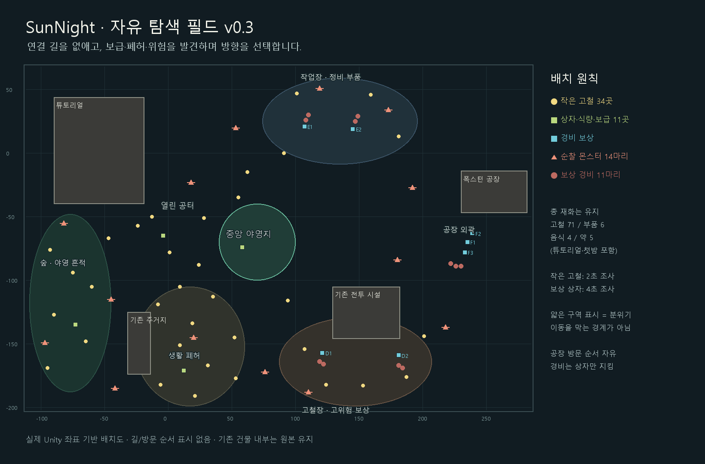

# SunNight 첫 필드 레벨디자인 v0.3 — 자유 탐색과 분산 파밍

작성·Unity 반영: 2026-10-29 / `feature/level-design`

이 문서는 [v0.2](SunNight_레벨디자인안_v0.2.md)의 지역 간 연결 길, 수집 지점 위치, 필드 몬스터 배치를 대체한다. 제작·연구 비용과 첫 구간 자원 총량은 유지한다. 전투·허기·씬 전환의 구현 상태는 [밸런스 검증 기록](SunNight_밸런스검증_v0.2.md)을 함께 따른다.

2026-10-29 후속 조정: [첫밤 이후 탐색·보스 검증](SunNight_첫밤이후탐색보스검증_v0.3.md)에 따라 U3·U4는 구매 시 증가한 최대 HP만큼 현재 HP도 늘리며 기존 손상량을 보존한다. 저장·씬 전환으로 이 효과를 반복 적용하지 않는다. 자원 배치·연구 비용은 유지하고, 공장 선행전 고정 구성 및 플레이어 전용 레이저·중앙 코어 노출을 첫 필드 보스에 적용한다.

## 1. 플레이 경험

튜토리얼을 나가면 공터·숲·폐허를 여러 방향으로 가로지를 수 있다. 가까운 보급, 멀리 보이는 건물, 순찰하는 적을 보고 목적지를 고른다. 정비가 필요하면 야영지로 돌아오고, 준비됐다고 판단하면 폭스턴 공장에 접근한다.

지역 번호를 따라 이동하거나 정해진 길을 완주하는 것이 목표가 아니다. 구역 이름과 색은 분위기·보상·위험을 설명하는 구분이며 이동을 막는 경계가 아니다. 튜토리얼과 원래 건물 내부의 벽·문은 유지한다.

## 2. 지형과 길

| 요소 | v0.3 반영 |
|---|---|
| 지역 간 연결 길 | 기존 10개 연결선의 바닥 흔적 제거. 대체 연결 길을 그리지 않음 |
| 남기는 도로 | 주거지·고철장·공장 앞의 짧고 끊어진 흔적 3곳, 총 46타일 |
| 지면 변화 | 야영지 설치 공간과 폐허 주변의 작은 흙 패치. 서로 이어지지 않음 |
| 장식 | 234 → 404개. 길 양옆 정렬 대신 공터·잔해·숲의 작은 무리로 분산 |
| 이동 공간 | 새 장식에 충돌벽을 추가하지 않음. 여러 방향으로 접근·우회 가능 |
| 야영지 | (70, -70)의 설치 공터 유지. 작업대 (58, -69), 적 배치 중심과 최소 30칸 거리 |
| 길 찾기 | 야영지 공터와 생활 잔해, 북동 작업장, 남동 고철장, 동쪽 대형 공장으로 방향 인지 |

v0.2 바닥 장식 4,588타일 중 야영지를 제외한 연결 길은 4,308타일이었다. v0.3의 도로 흔적은 46타일로 약 99% 감소했다. 작은 지면 패치·야영지까지 포함한 새 바닥 장식은 1,541타일이다. 기존 튜토리얼·건물 내부 바닥은 이 수치에 포함하지 않는다.

## 3. 파밍 배치와 보상

기존 고철 묶음을 **고철 1개짜리 잔해 34곳**으로 나눈다. 작은 잔해는 2초 조사, 음식과 주요 보상 상자는 기존 4초 조사를 사용한다. 이동·피격·입력 취소 시 조사가 중단된다. 가방이 부족하면 미수령분이 남는다.

| 생활권 | 분포 | 고철 | 부품 | 음식 | 약 |
|---|---|---:|---:|---:|---:|
| 튜토리얼 | 기존 학습 구역 | 7 | 0 | 1 | 0 |
| 열린 공터 A | 출구 남쪽·동쪽·북동쪽, 작은 잔해 9곳 + 음식 1곳 | 9 | 0 | 1 | 0 |
| 생활 폐허 B | 기존 건물 바깥 북·동·남쪽, 작은 잔해 9곳 + 음식 1곳 | 9 | 0 | 1 | 0 |
| 숲 C | 북쪽 공터부터 남쪽 야영 흔적까지, 작은 잔해 6곳 + 음식 1곳 | 6 | 0 | 1 | 0 |
| 남동 고철장 D | 바깥 잔해 6곳 + 경비 상자 2곳 | 18 | 2 | 0 | 1 |
| 북동 작업장 E | 바깥 잔해 4곳 + 경비 상자 2곳 | 12 | 4 | 0 | 2 |
| 공장 외곽 F | 경비 보상 3곳 | 6 | 0 | 0 | 1 |
| 첫밤 보급 N1 | 야영지 보급. 고철은 완료 시 자동 지급, 부족분은 보급함 | 4 | 0 | 0 | 1 |
| **합계** | 튜토리얼 외 보급 지점 **45곳** | **71** | **6** | **4** | **5** |

파밍 가능한 잔해·상자 위에는 작은 자원 아이콘을 표시하고, 전부 수령하면 아이콘을 숨기고 물체를 회색으로 바꾼다. 장식용 잔해에는 이 표시가 없다. 경비 보상 표시에는 청록색을 사용한다.

첫날 화면 탐색 검증 후 공터의 A1_s2를 **(-13, -50)**, A3_s1을 **(55, -35)**로 조정했다. 기존 위치에서 각각 약 7.8칸·8칸 이동해 주변을 탐색할 때 자원 표시를 발견하기 쉽게 한다. 수량·지속 ID·조사 시간은 유지한다. 위 배치도와 Unity 데이터에 반영했다.

일반 고철은 자유롭게 접근할 수 있다. 부품이 포함된 D1/D2/E1/E2 상자는 해당 경비를 처치해야 열린다. 이 조건은 상자에만 적용되며 길이나 공장 입장을 잠그는 조건으로 추가하지 않는다. 이번 개정은 무한 재생성 파밍을 도입하지 않는다.

## 4. 몬스터를 만나는 방식

### 보상 경비 11마리

기존 경비 그룹 D1·D2·E1·E2·F와 지속 ID를 유지한다. 고철장에는 근접 적, 작업장과 공장 외곽에는 근접·원거리 혼합을 둔다. 부품을 얻으려면 전투가 필요하지만, 단순히 해당 지역을 지나갈 때는 돌아갈 공간을 남긴다.

### 순찰 14마리

숲 가장자리, 폐주거지 외곽, 북쪽 공터, 고철장 외곽, 공장 접근 지역에 배치한다. 근접 12·원거리 2마리이며 보상 경비와 별개의 개체다. 기존 이벤트 구역의 몬스터는 별도로 유지한다.

- 자기 구역 중심에서 좌우 3칸을 기본 이동속도의 50%로 순찰한다. 끝점에서 1.5초 쉰다.
- 기존 감지 트리거로 플레이어를 발견하면 기존 공격·추격 AI로 전환한다.
- 중심에서 12칸을 넘는 추격을 중단하고 돌아온다. 기존 경비와 마찬가지로 복귀 시 체력을 회복해 경계 밖에서 반복 공격하는 방식을 막는다.
- 순찰 구역은 야영지와 분리한다. 공터 전체를 위험 구역으로 채우지 않는다.
- 개별 무작위 재료·코인 드롭은 없다. 처치한 순찰 개체는 탐색 저장 이력에 기록하며 같은 진행 상태에서 다시 생성하지 않는다.

첫날 탐색 실측 후 폐주거지 순찰 P04의 중심을 **(43, -125) → (20, -145)**로 옮겼다. 기존 위치에서는 남쪽 재료 14개 확보까지 적을 한 마리도 만나지 않았다. 개체 수와 능력치를 유지하면서 자원 사이를 가로지를 때 순찰을 보고 피하거나 대응할 수 있도록 조정했다. [첫날 탐색 검증 기록](SunNight_첫날탐색검증_v0.3.md)에 조건·실측·제한을 구분한다.

이는 일정 시간마다 플레이어 주변에 갑자기 생성하는 무한 스폰 방식이 아니다. 맵에 들어갈 때 미처치 개체를 배치하고, 이동 중 그 구역에 들어가면 자연스럽게 만나도록 한다.

## 5. 강화와 폭스턴 접근

중앙 야영지는 강제 경유 교차로가 아니라 정비·연구·저장을 위해 돌아오는 안전 공간이다. 연구는 현재 구현대로 첫밤 이후 해금한다. 탐색 지역의 방문 순서는 정하지 않는다.

| 연구 | 비용 | 효과 |
|---|---|---|
| U1 배트 보강 | 고철 6 + 부품 1 | 피해 6 → 9 |
| U2 대포 포신 | 고철 8 + 부품 2 | 피해 5 → 7 |
| U3 방어판 | 고철 6 + 부품 1 | 대포 최대 HP 30, 벽 45 |
| U4 거점 프레임 | 고철 8 + 부품 2 | 거점 최대 HP 650, 대포 상한 4 |

제작비는 대포 5·벽 1을 유지한다. 모든 지역을 방문하거나 모든 연구를 마쳐야 공장으로 갈 수 있는 새 조건은 추가하지 않는다. 공장으로 향하는 긴 가로등 줄이나 연결 도로도 만들지 않는다.

## 6. 기존 저장과의 호환

작은 잔해는 기존 A1~C2·D0·E0 묶음의 총량을 분할한다. 저장의 `layoutVersion`을 3으로 올리면서 기존 수령량을 각 조각에 순서대로 배분한다. 예를 들어 이전 A1에서 3개를 받았다면 새 A1·A1_s1·A1_s2는 모두 고갈 상태다. 2개만 받았다면 한 조각만 남는다.

변환은 인벤토리에 자원을 지급하지 않으며 반복해도 수령량을 늘리지 않는다. 기존 경비 처치·연구·튜토리얼·첫밤 수령 이력은 유지한다. 이전 저장에서 새로 추가된 순찰은 미처치 상태로 등장한다.

## 7. Unity 반영과 검증

- `FirstFieldDressing.prefab`을 재생성하고 `Resources/Exploration/Content.asset`의 실제 배치를 갱신했다. `TutorialScene.unity`는 이번 작업 전후 파일 해시가 같다.
- 고철 71·부품 6·음식 4·약 5, 연구비와 기존 보급 ID 호환을 검사했다.
- 보급 45곳의 중심과 최소 세 방향 접근 공간, 경비 생성 위치와 순찰 왕복 구간에 고정 충돌체 겹침이 없다.
- 반경 0.7, 간격 2의 공간 탐색과 구간 충돌 검사에서 야영지로부터 45곳 모두 연결됐다. 지정된 길의 좌표만 검사한 결과가 아니다.
- 실제 Play Mode에서 프레임 진행, 14마리 순찰 이동, 상호작용 수집·취소·중복 차단, 추적·복귀, 저장 이력 변환과 개체 재생성 방지를 확인했다. 시험 시작 위치와 처치 이력 검증용 피해는 주입했으며 전체 플레이 밸런스 시험으로 간주하지 않는다.
- 최종 Unity 컴파일 성공, Play Mode 검사 17개 통과. [공터 실행 화면](level-design/v03-salvage-play.png), [숲 실행 화면](level-design/v03-forest-play.png), [전체 맵 렌더](level-design/v03-overview.png). 캡처는 검토용 카메라와 표준 낮 밝기로 렌더링했다.
- [기존 파밍·연구 회귀검사 19개](level-design/v03-research-regression.json)도 통과했다. 큰 상자의 부분 수령, 경비 처치 후 해금, 연구 취소·비용·중복 구매 방지·강화 시 체력 보존을 확인했다.

실제 배치 데이터와 검사 결과: [배치 검사](level-design/v03-layout-audit.json), [공간 연결 검사](level-design/v03-connectivity.json), [실행 검사](level-design/v03-playtest.json). 재현 도구: `Tools/OpenFieldAudit.cs`, `Tools/OpenFieldPlaytest.cs`, `Tools/draw-open-field-map.py`.

첫날의 실제 이동·수집·제작·설치 시간과 이동 중 피격은 [첫날 탐색 검증 기록](SunNight_첫날탐색검증_v0.3.md)으로 추가 확인한다. 초보자 사람 표본, 모든 적을 처치하는 전투, 폭스턴까지의 연속 플레이 난이도는 이 시험에 포함하지 않는다. 기존 운반 방식·시설 수리·전체 실패 복귀 구현의 한계는 이전 검증 기록에 남긴 상태다.

첫밤의 시설 손실·음식 소비와 파밍부터의 연속 진행은 [첫밤 방어 검증](SunNight_첫밤방어검증_v0.3.md)에 추가 기록했다. 첫밤 시각은 21:30에 유지하고 적 전멸 시 둘째 날 05:30으로 전환하며, 전투 중 허기는 계속 소모한다.
