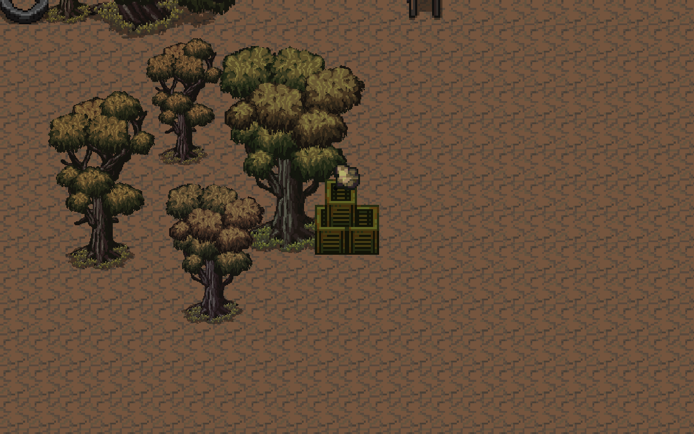
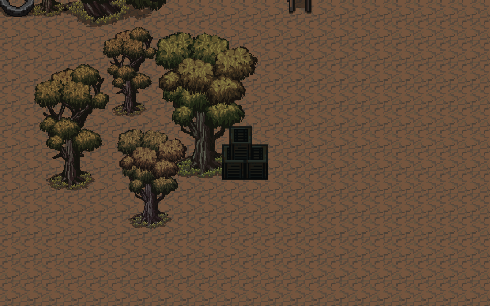

# 외곽 조사 잔해 — 2026-11-02

외곽 156개 장식 묶음마다 앞쪽 잔해 1개를 실제 조사 대상으로 등록했다. 나머지 나무·가구·타이어는 장식이다. 플레이 중 조사 대상은 금빛 색상과 머리 위 고철 아이콘으로 구분한다. 1초 조사하면 고철 조각을 얻으며, 10조각마다 고철 1개가 자동으로 인벤토리에 들어간다. 접근 안내에 해당 잔해 보상과 현재 조각 진행도를 표시한다.

모두 조사하면 아이콘이 꺼지고 잔해는 어두워진 채 남는다. 오브젝트와 주변 풍경은 사라지지 않는다. 잔여 조각과 수령 내역은 체크포인트에 저장된다. 이동·피격 시 조사를 취소한다. 고철을 지급해야 하는 순간 가방이 가득 차면 해당 잔해의 조각을 소비하지 않아 공간을 확보한 뒤 재조사할 수 있다.

## 자원 배분

| 항목 | 변경 후 |
|---|---:|
| 주요 파밍 지점 주변 잔해 | 31개 × 조각 5개 |
| 나머지 외곽 잔해 | 125개 × 조각 1개 |
| 외곽 총량 | 280조각 = 고철 28개 |
| 탐색 콘텐츠 전체 고철 | 기존과 같은 64개 |
| 정비 부품 / 식량 / 약 | 기존 6 / 3 / 5개 유지 |
| 적 배치 | 기존 25개 유지 |

고철 28개는 D0_s2~s5, E0/E0_s1~s3, D1/D2/E1/E2에 있던 고철을 옮긴 것이다. 원래 정의는 저장 호환성을 위해 유지하고 런타임에서 해당 고철 보상만 제외한다. D1/D2/E1/E2의 부품·약은 기존 경비 처치 조건으로 남는다. 첫날 A/B/C 및 제작·강화 비용은 바꾸지 않았다.

기존 저장에서 이 28개 중 받은 수량만큼 새 잔해를 수령 상태로 이관한다. 인벤토리에는 추가 지급하지 않는다. 이관 순서는 고정된 묶음 ID 순서이므로 예전 저장에서는 일부 외곽 잔해가 이미 비어 있을 수 있다.

## 검증

- 최초 등록 테스트가 미구현 상태에서 실패하는 것을 확인한 뒤 구현했다.
- 156묶음 등록, 총 280조각, 고철 총량 64개 확인.
- 기존 외곽 고철 수령량 0~28개인 29가지 저장 상태: 남은 수령량과 기수령량의 합이 항상 28개. 반복 이관·반복 채집에서 중복 지급 없음.
- 테스트 중 조각 수령마다 JSON 저장/복원을 수행한 4,524회 왕복 검사 통과.
- 가방 가득 참 상황의 장부 무변경 검사 통과.
- Play Mode 실제 PlayerInteract 동작으로 조사, 이동 취소, 어두운 잔해와 아이콘 숨김, 실제 체크포인트 저장·씬 재로딩 검증.
- Unity 6000.5.10f1 컴파일 통과. 코드 검토에서 발견한 콘텐츠와 프리팹 저장 순서 문제를 수정했다.

처음에는 6조각당 고철 1개, 156묶음에 168조각을 거의 균등하게 배분했다. 북부 9묶음 파밍 후 야영지 복귀가 게임 시간 151.7초에 고철 1개와 조각 3개여서 보상이 부족했다. 최종안은 총 고철량을 늘리지 않고 주요 지점 주변에 많은 조각을 배분하는 방식으로 조정했다.

같은 북부 9묶음을 최종 배분으로 재검증한 결과, 154.5초에 29조각(고철 2개 + 잔여 9조각), 복귀 HP 83, 실제 추적 적 3마리였다. 시작 위치만 야영지에 고정했으며 이동·전투·조사는 실제 컨트롤러를 사용했다. 게임 배속 2배의 자동 입력 시험이므로 실제 경과 시간은 77.3초였다. 정지 입력이 다음 물리 프레임에 반영되기 전 조사하면 취소될 수 있어, 테스트 도구가 이동 종료 후 게임 시간 0.3초 기다리도록 보정했다. 최종 동선 실행의 error는 null이며 야영지 복귀를 확인했다.

보상이 많은 잔해 7곳의 실제 상호작용 시험에서도 35조각 → 고철 3개 + 잔여 5조각, 이동 취소, 빈 잔해 유지, 아이콘 숨김, 저장·씬 재진입 후 수령 상태 유지를 확인했다. 부품·약 상자는 이 동선 시험에서 수령하지 않았다. 이동 거리는 약 617유닛이었다.

자동 입력 테스트는 사람이 처음 탐색하는 평균 시간을 뜻하지 않는다. 외곽에 보상이 분산되어 이전 버전의 상자 집중 파밍 수치를 그대로 적용할 수 없다. 모든 지역의 강화 완료 시간과 폭스턴까지 전체 진행 속도를 재검증한 것은 아니다.

빠른 반복 씬 로딩 중 기존 UI_HotBar.cs:84 및 UI_Produce.cs:101의 Addressables 완료 콜백에서 파괴된 오브젝트를 참조하는 오류 2종을 관찰했다(이번 검사 누적 6회). 이번 범위에서는 관련 UI 코드를 수정하지 않았다. 기존 입력 장치 연결 관련 경고도 별도이며, 경고·오류가 전혀 없는 상태라고 주장하지 않는다.

코드/데이터: OuterSalvageLedger, FieldReward, ExplorationRuntime, ExplorationContent, OuterSalvageAuthoring, OuterFieldDressing, FirstFieldLevelDesign 및 Content.asset/FirstFieldDressing.prefab.

검증 도구: Tools/OuterSalvageAudit.cs, Tools/OuterBalanceAudit.cs. 변경 전 백업: Logs/OuterSalvage/before.zip. 커밋·푸시는 수행하지 않았다.

종료 상태: Unity Edit Mode. 기존 auto-tick 설정은 유지했다. 현재 브랜치는 feature/level-design.

증거: [장부 검증](level-design/v03-salvage-contract.json), [Play Mode 검증](level-design/v03-salvage-play.json), [북부 왕복 검증](level-design/v03-salvage-north-route.json).

조사 전:

조사 후:

