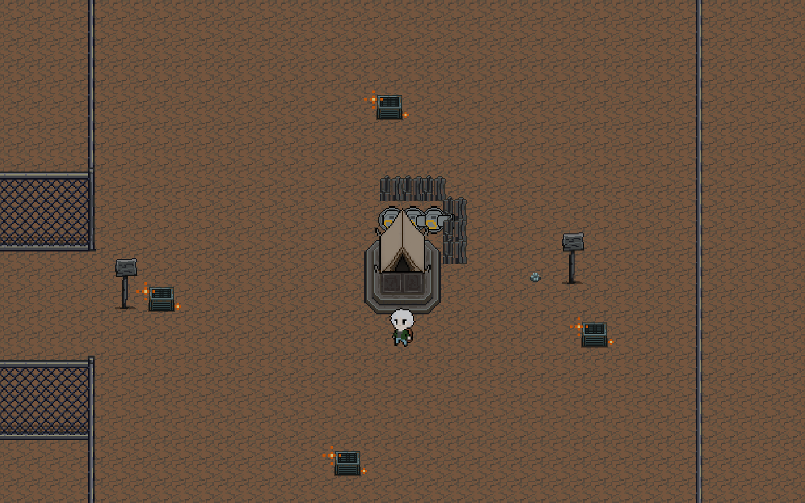

# SunNight v0.3 첫날 탐색·파밍 검증

검증일: 2026-10-29 / 브랜치: `feature/level-design`

후속 검증: 이 배치에서 실제 파밍·제작한 시설로 첫밤까지 진행한 결과는 [첫밤 방어 검증](SunNight_첫밤방어검증_v0.3.md)에 별도로 기록한다.

## 검증 방법

실제 Unity 6000.5.10f1 Play Mode에서 플레이어의 이동·충돌, 적의 감지·추격, 상호작용 조사, 제작 UI의 재료 차감과 건설을 실행했다. `Tools/FirstDayFieldAudit.cs`로 알려진 좌표를 따르는 시험과, 실제 카메라 시야 안에 들어온 자원만 발견 대상으로 삼는 시험을 구분했다. 사람이 처음 맵을 보며 플레이한 기록은 아니다.

시험 시작에만 튜토리얼 완료 직후(C1) 상태를 설정했다. 플레이어 (-33, -42), 거점 (-33, -19), HP 100, 허기 30, 배트 1·식량 1, 설치된 대포 1·벽 2, 잔여 고철 0, 첫날 05:30이다. 튜토리얼에서 받은 고철 7개를 대포 1기와 벽 2개에 사용한 상태다. 튜토리얼 전투 자체는 이번 측정 구간에 포함하지 않았다.

이후에는 순간이동·재료 지급·적 제거·피해 주입 없이 기본 속도 5로 걸었다. 달리기와 플레이어 공격을 사용하지 않았으며 시간 배율은 1이다. 작은 잔해는 실제 2초, 음식은 실제 4초 조사했다. 매 수집 지점에 확인 시간 3초, 제작마다 선택 시간 2초, 설치마다 5초를 추가해 측정 시간에 포함했다.

고철 14개를 모아 귀환한 뒤 제작 창에서 대포 2기(10개)·벽 4개(4개)를 제작했다. 단축 슬롯으로 시설을 선택한 뒤 실제 설치 가능 칸에 건설했다. 헤드리스 실행에 마우스 장치가 없어 `BuildItem()`의 좌표 처리 이후를 공용 `BuildAtWorldPoint()`로 분리했다. 일반 마우스 입력도 같은 메서드를 호출하며 건설 가능 여부·대포 상한·UI 상태·아이템 차감 검사를 공유한다.

첫날 낮은 게임 시각 05:30~21:30, 실제 **480초**다. 20:00 경고는 시작 후 **435초**다. 완료 기준은 실제 설치된 대포 3기·벽 6개, 재료 14개 소비, 사망 없음이다. 자동 조작에서 측정하지 못하는 추가 길 찾기·설명 읽기 시간 90초를 별도 계산하되 실제 측정값으로 합치지 않는다.

## 배치 조정

남쪽 기존 배치에서는 고철 14개와 음식 2개를 추가로 모을 때까지 적 감지가 0회였고, 10칸 이내의 필드 적도 없었다. 필요한 재료를 확보하는 동안 위험 요소가 지나치게 멀리 떨어져 있었다.

폐주거지 근접 순찰 **P04의 중심을 (43, -125)에서 (20, -145)로 이동**했다. 추가 스폰 없이 기존 25마리(경비 11·순찰 14)를 유지한다. 순찰 폭 ±3, 기본 속도의 50%, 추격 중심 반경 12, 복귀 회복 규칙도 그대로다. 고정 길이나 벽을 추가하지 않았고, 자원 사이를 가로지르거나 적을 보고 돌아갈 수 있다.

자원 지점 45곳과 총량 고철 71·부품 6·음식 4·약 5, 제작비 대포 5·벽 1, 낮 시간 480초는 유지한다. 첫날 자원에 부품 상자 전투나 특정 지역 방문 조건을 추가하지 않는다.

화면 탐색 시험은 카메라 크기 9·4:3 화면에서 자원 표시 중심이 화면 안쪽 96%에 들어와야 발견한다. 발견한 위치는 기억하며, 발견 전에는 자원 좌표를 목적지로 사용하지 않는다. 공터·폐주거지를 넓게 훑는 탐색 지점만 미리 지정했으며 적 회피나 최단 경로를 계산하지 않았다. 고철을 우선 조사하고 음식은 수집하지 않았다. 이는 픽셀을 보고 판단하는 사람이 아닌 카메라 좌표 기반 가시성 검사이며, UI 가림이나 사람의 주의력은 재현하지 않는다.

조정 전에는 이 탐색 범위를 267.6초 동안 훑고 고철 13개만 발견했다. 시간이 끝난 것은 아니고, 지정된 탐색 범위를 마쳤을 때 1개가 부족한 결과다. 실제 플레이어는 남은 약 212초 동안 다른 곳을 더 탐색할 수 있으므로 이를 첫날 자체가 불가능하다는 뜻으로 해석하지 않는다. 다만 알려진 좌표 시험과 발견 난도의 차이가 컸다.

이에 공터 잔해 2곳을 옮겼다. **A1_s2: (-7, -45) → (-13, -50)**는 이웃 잔해를 조사할 때 시야에 들도록, **A3_s1: (47, -35) → (55, -35)**는 공터 동쪽을 훑을 때 놓치기 덜 쉽도록 변경했다. 이동 거리는 각각 약 7.8칸·8칸이다. 기존 ID·보상 1개·수령 이력을 유지하고, 길을 만들거나 자원을 일렬로 연결하지 않았다. 같은 탐색 알고리즘과 같은 화면 비율로 변경 후 재시험했다.

## 실행 결과

| 시험 | 자원 배치 시점 | 준비 완료 | 밤까지 여유 | 추가 탐색 90초 가정 후 여유 | HP / 허기 | 남은 음식 | 필드 적 감지 / 피격 |
|---|---|---:|---:|---:|---|---:|---|
| 서쪽 숲 + 공터 | 순찰 조정 후, 잔해 2곳 이동 전 | 259.2초 (4분 19초) | 220.8초 | 130.8초 | 95 / 17.0 | 3 | 2마리 / 1회 |
| 북동 작업장 외곽 + 공터·고철장 외곽 | 순찰 조정 후, 잔해 2곳 이동 전 | 268.3초 (4분 28초) | 211.7초 | 121.7초 | 100 / 16.6 | 2 | 2마리 / 0회 |
| 화면 안에서 발견하며 공터·폐주거지 탐색 | **순찰·잔해 조정 후 최종 배치** | **329.5초 (5분 29초)** | **150.5초** | **60.5초** | **100 / 13.5** | **1** | **0마리 / 0회** |

두 방향은 모두 필드 고철 14개를 실제 수집·소비해 대포 3기와 벽 6개를 설치했다. 서쪽은 P02·P03, 동쪽은 P07·P08과 마주쳤고, 동시 10칸 이내 필드 적은 최대 1마리였다. 추격 누적은 각각 7.5초·7.3초였다. 음식은 먹지 않았다. 잔해 2곳을 옮긴 뒤 이 두 고정 경로를 다시 측정한 값은 아니며, 최종 배치의 검증은 아래 화면 탐색 재시험으로 구분한다.

원본: [서쪽](level-design/v03-firstday-west.json), [동쪽](level-design/v03-firstday-east.json), [화면 탐색 조정 전](level-design/v03-firstday-search-before.json).

최종 화면 탐색은 **258.7초에 고철 14개 확보, 329.5초에 대포 3기·벽 6개 설치**로 완료했다. 총 보행 거리는 약 1,031칸이다. 최종 재료 잔량 0은 제작비 14개를 모두 소비한 결과다. 시작에 받은 식량 1개는 먹지 않았고 추가 음식 수집도 하지 않았다. 적이 10칸 이내로 들어온 경우는 최대 1마리였지만 감지·추격은 발생하지 않았다. 순찰을 만나지 않고도 준비할 수 있는 접근은 허용한다. 모든 탐색에서 전투를 강제하는 배치로 바꾸지는 않았다.

최종 원본: [화면 탐색 조정 후](level-design/v03-firstday-search-after.json). 아래는 실제 준비 완료 상태를 검토용 카메라와 표준 낮 밝기로 렌더링한 화면이다. 일반 플레이 카메라·HUD 캡처는 아니다.

## 판정과 유지하는 수치

이번 조건에서는 **첫날 8분을 늘리거나 재료 총량을 늘릴 필요는 없다.** 최종 화면 탐색에 추가 90초를 가정해도 밤까지 약 60.5초, 첫 경고까지 약 15.5초가 남는다. 이 90초는 여유 예산이며 실제 초보자 시험값이 아니다.

몬스터는 첫날 파밍을 반드시 막는 적이 아니라 알아차리고 피해 가거나 전투를 선택할 수 있는 수준으로 유지한다. 남쪽 기존 위치의 완전한 무조우 구간은 P04 재배치로 보완했다. 알려진 남쪽 경로의 동일 수집 구간에서 감지 0 → 1마리, 추격 약 3.1초, 피해 0으로 바뀌었고 고철 14개 확보 시간은 176.6초로 사실상 같았다. 이 비교는 설치 검사 도구 수정 전의 파밍 구간만 사용한 결과다. [조정 전 진단](level-design/v03-firstday-south-diagnostic-before.json), [조정 후 진단](level-design/v03-firstday-south-diagnostic-after.json).

잔해의 **발견 가능성**이 자원 부족보다 먼저 드러난 문제였으므로 공터 2곳의 위치를 보완했다. 첫밤 방어와 이후 탐색에 쓰는 음식 예산까지 줄이지 않는다. 준비 과정에서 음식이 남았다는 이유만으로 식량을 감축하지 않는다.

최종 Unity 컴파일 오류 0, 수집 45곳 모두 공간 연결, 모든 수집 중심·세 방향 이상 접근과 순찰 구간의 고정 충돌 검사 통과. [최신 배치 검사](level-design/v03-layout-audit.json), [연결 검사](level-design/v03-connectivity.json), [수정 배치도](level-design/v03-open-field-layout.png). TutorialScene 직렬화 파일의 SHA-256은 작업 전후 `EA5B240C29A27FA494296C44091F72F7E61B546E437F1EA31E44B1C8D4C6365D`로 같고, 실제 변경은 생성 프리팹과 Exploration Content에 반영했다.

## 해석 범위와 재현

이 시험은 여러 방향으로 이동하며 첫날 방어 시설을 준비할 수 있는지와 이동 중 적 밀도를 검증한다. 좌표를 아는 자동 이동이므로 초보자의 길 찾기 시간과 전투 조작 실력을 대표하지 않는다. 공격하지 않고 통과했으므로 적을 모두 처치하는 전투 난이도나 첫밤 방어 성공률을 이 결과로 단정하지 않는다.

초기 진단 실행의 실패도 보존한다. 첫 실행은 검사 도구가 거점 점유 칸 (1, -1)을 건설 대상으로 선택해 중단됐고, 다음 실행은 시설 변경 시 단축 슬롯 선택을 생략해 중단됐다. 두 실행은 파밍 배치 비교에만 사용하며 준비 완료 성공 표본에 포함하지 않는다. 도구 수정 후 새 Play Mode에서 시작부터 다시 실행한다.

재현: 새 TutorialScene Play Mode에서 `Tools/FirstDayFieldAudit.cs`의 `FirstDayFieldAudit.Run`에 `west-final`, `east-final`, `search-adjusted`를 각각 전달한다. 각 실행 사이 Play Mode를 종료·재시작한다. 결과는 `Logs/FirstDayV03/`에 저장한다. `success`와 `error`를 확인해야 하며 CLI 명령 성공만으로 플레이 성공으로 판정하지 않는다. 조정 전 자료의 `search-final`이라는 실행명은 최종 배치를 뜻하지 않는다. 당시 공통 `policy` 문자열은 이동 동작을 설명하며, 발견 대상 선택에는 실제로 `SearchVisibleSupplies()`의 시야 제한을 사용했다.

Unity 실행·검증 절차에는 로컬 `unity-cli/SKILL.md`, `unity-pipeline/SKILL.md`를 사용했다. 이번 기록은 연속된 튜토리얼→첫밤→폭스턴 클리어 결과가 아니다.
