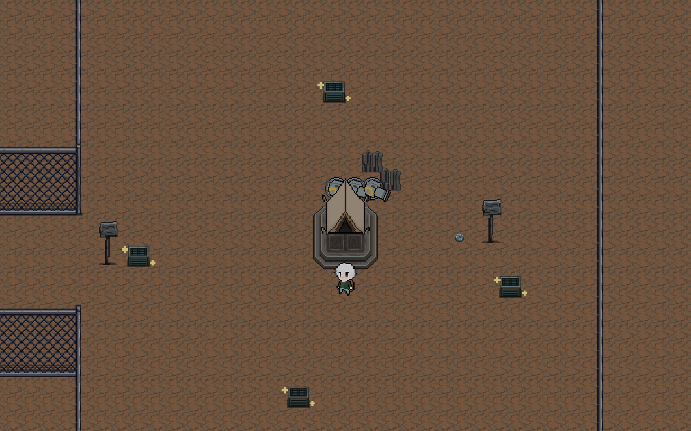

# SunNight v0.3 첫날 파밍부터 첫밤 방어까지

검증일: 2026-10-29 / 브랜치: `feature/level-design`

최종 결과: 실제 파밍·제작한 대포 3기·벽 6개로 첫밤을 **84.8초에 클리어**했다. 플레이어·거점 무피해, 대포 3기 생존, 벽 4개 소실, 음식 1개 사용 후 허기 13.76이다. 난이도·식량 수치는 유지하고, 전투가 끝나기 전에 자정을 넘던 시계를 첫밤 21:30 고정으로 수정했다.

## 시험 조건

[첫날 탐색 검증](SunNight_첫날탐색검증_v0.3.md)에서 사용한 최종 맵과 화면 탐색 방식을 다시 실행하고, 같은 플레이 상태로 첫밤까지 이어 간다. Unity Play Mode의 실제 이동·충돌·수집·제작·시설 공격·적 AI·아이템 사용 로직을 자동 조작한다. 사람의 수동 플레이 표본은 아니다.

시작할 때만 튜토리얼 완료 상태(C1)를 설정한다. HP 100, 허기 30, 배트 1·구운 고기 1, 대포 1·벽 2, 고철 0, 거점 (-33, -19), 첫날 05:30이다. 이후 고철 14개를 실제 조사로 획득하고, 대포 2기와 벽 4개를 제작·설치해 3기·6개를 완성한다. 추가 음식은 줍지 않는다.

시설의 최종 상대 타일 배치는 대포 (-1,1)·(0,1)·(1,1), 벽 (-1,2)·(0,2)·(1,2)·(2,-1)·(2,0)·(2,1)이다. 이 배치와 거점 위치에서의 결과이며 모든 임의 배치의 결과를 대표하지 않는다.

준비 후 시간을 건너뛰거나 배속하지 않고 낮 480초가 자연스럽게 끝나도록 둔다. 첫밤은 기존 설정인 근접 12·원거리 3마리, 첫 생성 전 5초, 개체 사이 2초, 묶음 전멸 후 휴식 10초, 북·동쪽 12칸 접근을 사용한다. 수리·시설 추가·플레이어 공격·회복약 사용은 하지 않는다. 적이 3칸 안에 들어오면 기본 속도로 물러나고, 안전하면 거점 남쪽 4칸 지점으로 돌아온다.

시험 도구는 허기 8 이하에서 단축 슬롯의 구운 고기를 선택하고, 임시 키보드 장치의 F13 입력을 `EatActoin`에 연결해 소비한다. 허기 값을 직접 더하거나 음식 수량을 직접 빼지 않는다. 게임에 자동 식사 기능을 추가한 것은 아니다. 실제 음식 1개 차감과 허기 12 회복을 확인한다.

첫밤 성공은 예정된 15마리 생성·처치, 플레이어·거점 생존, `firstNightCleared` 성립으로 판정한다. 시설 개별 내구도와 파괴 수, 거점 최소 HP, 음식 사용, 허기 최솟값·종료값을 기록한다. 초안의 거점 HP 300 이상·대포 2기 이상 생존과 90~120초 목표를 참고하되, 이번 기본 시험에는 배트 공격이 포함되지 않는다.

## 실행 결과

| 항목 | 시계 수정 전 실측 |
|---|---:|
| 첫밤 시작부터 전멸까지 | 84.8초 |
| 생성 / 처치 | 근접 12·원거리 3 / 15마리 전멸 |
| 동시 생존 야간 적 최대 | 5마리 |
| 플레이어 HP | 100 → 100 |
| 거점 HP | 500 → 500 |
| 대포 | 3기 모두 생존, 각각 HP 20 |
| 벽 | 6개 중 4개 파괴, 생존 2개 HP 30·27 |
| 사용 음식 | 구운 고기 1개 |
| 밤 시작 / 종료 허기 | 약 18 / 13.76 |
| 굶주림 피해 / 저허기 감속 | 발생 없음 |
| 첫밤 보상 | 고철 4개 실제 수령 |

식사는 첫날 활성 시간 약 441초에 이뤄졌다. 실제 허기 7.965 → 19.949로 회복했고 음식 1개가 차감됐다. 입력 처리 중에도 시간이 흘러 최종 수치는 정확히 +12보다 약간 작다. 낮과 밤 전체의 총 활성 시간은 약 565초이며, `30 − 565 × 0.05 + 12 ≈ 13.75`로 실측 허기와 일치한다.

수정 전 실행에는 검사 환경의 키보드 포커스 차단을 진단하는 중단이 있었다. 그동안 시계·허기 소모를 멈추고 파밍한 인벤토리·설치 시설·체력을 그대로 둔 뒤 같은 실행을 이어 갔다. 중단 시간을 활성 플레이 시간에 합산하지 않았다. 이 환경 문제는 테스트 도구에서만 배경 입력과 Game View 입력 전달을 잠시 허용하고 종료 시 원복해 해결했다. 후속 최종 재시험은 C1부터 다시 시작했다.

원본: [수정 전 첫밤 결과](level-design/v03-firstnight-before.json), [전투 중 시계와 전력 관측](level-design/v03-firstnight-clock-before.json).

### 수정 후 최종 연속 재시험

C1부터 다시 시작해 이번에는 검사 도구 중단 없이 파밍·제작·대기·식사·첫밤 전투를 연속 수행했다. 준비 완료는 329.45초, 첫밤 시작은 약 480.1초, 마지막 처치는 약 564.9초였다. 이후 5초간 완료 상태를 더 관찰해 전체 기록은 569.90초다. 이 마지막 5초를 전투 시간에 더하지 않았다.

- 첫밤 **84.77초**, 생성·처치 각 15마리, 동시 생존 최대 5마리.
- 플레이어 HP **100**, 거점 HP **500**, 대포 3기 모두 **20/20**.
- 벽 4개 파괴, 생존 벽 2개는 **30/30·27/30**. 수정 전 결과와 같다.
- 음식 **1개**를 440.36초 무렵 사용. 허기 **7.997 → 19.982**, 밤 시작 약 **18**, 완료 **13.757**. 굶주림 피해·저허기 감속 없음.
- 전투 중 시계 최솟값·최댓값 모두 **1290(21:30)**, 날짜는 첫째 날 유지.
- 완료 후 **둘째 날 05:30**, 고철 **4개** 수령. 추가 5초 동안 시계·허기·HP·재료 변화와 추가 웨이브 생성 없음.

회피 정책은 적용했지만 이 배치에서는 플레이어에게 3칸 이내로 접근하는 적이 없어, 준비 후 실제 추가 이동 없이 방어했다. 배트 참여와의 직접 비교 결과로 해석하지 않는다.

원본: [수정 후 연속 실행](level-design/v03-firstnight-after.json), [실제로 획득·설치한 준비 상태](level-design/v03-firstnight-earned-preparation.json). 준비 상태 파일은 검사 기록용이며 현재 게임의 일반 이어하기 저장 파일로 취급하지 않는다.

화면은 실제 완료 상태를 검토용 카메라·표준 낮 밝기로 렌더링한 것이다. 게임 HUD 캡처는 아니다.

## 반영한 수정

기존 시계는 첫밤 전투 중에도 계속 진행해, 전투 약 75초 뒤 자정을 넘어 날짜를 변경했다. 관측값은 전투 83.97초에 시계 00:17.98, 적 1마리 생존이었다. 이후 마지막 처치에서 다시 둘째 날 05:30으로 전환됐다. 이는 기획의 첫밤 전투 중 21:30 고정과 다르다.

`TimeController.UpdateTime()`을 수정해 첫 구간 첫밤은 **첫째 날 21:30을 유지**하도록 했다. 적 AI·시설 공격·플레이어 이동·허기는 실제 시간대로 계속 진행한다. 모든 적을 처치한 기존 완료 처리에서 둘째 날 05:30으로 전환하며, 완료 후 시계와 허기 소모 정지도 유지한다. 시간 배율을 바꾼 수정이 아니다.

적 구성 12·3, 생성 간격, 피해·체력, 대포 5·벽 1의 제작비, 음식 회복 12·기본 허기 소모 0.05/초·보상 고철 4는 유지한다. 이번 배치에서 공격 없이도 클리어했지만 벽 4개를 소모했고, 제작한 대포를 보존하는 역할이 확인됐다. 90~120초 목표보다 약 5초 빠르다는 이유만으로 적을 추가하지 않는다.

걷기 중심 시험은 음식 1개로 종료 허기 12 이상을 확보했다. 달리기 추가 소모 0.10/초를 많이 사용하는 플레이는 다른 조건이며 이 결과를 음식 1개가 언제나 충분하다는 뜻으로 해석하지 않는다. 음식 공급을 줄이지 않는다. 첫밤 보상 4개는 소실 벽 4개의 재제작비와 같고, 생존 시설의 수리는 별도다.

같은 약 565초 동안 음식을 전혀 먹지 않았다면 계산상 종료 허기는 약 1.75로 저허기 기준 30/7보다 낮다. 이는 이번 측정 시간을 사용한 계산이며 무섭취 실험 결과는 아니다. 음식 1개는 걷기 중심 플레이의 저허기 위험을 피하고 다음 단계로 넘길 여유를 만드는 수준으로 판단한다.

## 재현과 한계

`Tools/FirstDayFieldAudit.cs`의 `FirstDayFieldAudit.Run`에 `search-night-clockfix`를 전달한다. 새 TutorialScene Play Mode에서만 실행한다. 첫날 탐색부터 첫밤까지 실시간으로 진행하므로 명령 제한 시간을 950초로 둔다. 실제 성공 여부는 결과 JSON의 `success`, `error`, `firstNightCleared`, 생성·처치 수, `nightClockMin/Max`, `postClearCheck`를 함께 확인한다. `resume` 실행명은 당시 중단된 살아 있는 시험 상태만 이어 가는 진단용이며 새 실행 재현에 사용하지 않는다.

최종 Unity 컴파일 오류 0, 첫밤 시계 고정 로그와 15마리 처치 로그 확인, `git diff --check` 통과. 테스트용 키보드는 제거하고 배경·Game View 입력 설정을 원복했다. TutorialScene 파일은 작업 전후 SHA-256 `EA5B240C29A27FA494296C44091F72F7E61B546E437F1EA31E44B1C8D4C6365D`로 동일하다.

시작 C1 상태는 시험 설정이며 튜토리얼 전투를 직접 완료한 기록은 아니다. 첫날 이후 시설과 재료는 이번 실행에서 실제 파밍·제작한 것들이다. 달리기, 배트 참여, 정지 방치, 다른 시설 배치, 실패 후 복귀의 일반적 성공률은 별도 조건이다.

사용한 실행 절차: 로컬 `unity-cli/SKILL.md`, `unity-cli/references/playmode-verification-loop.md`, `unity-pipeline/SKILL.md`.
