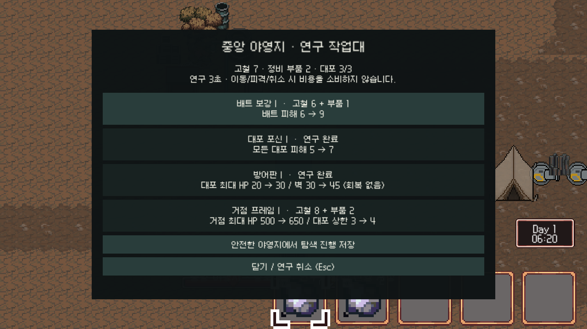

# SunNight 지역 보급·야영지 연구 구현 기록 v0.2

작성일: 2026-10-28 · 브랜치: `feature/level-design`

## 플레이 방법

1. `MainScene`에서 시작하면 `TutorialScene`의 기존 튜토리얼 뒤로 새 탐색 콘텐츠가 생성된다. 기존 입력 설정의 상호작용 키를 보급 상자 앞에서 4초간 누른다. 키를 놓거나 이동·피격하면 조사 진행이 취소된다.
2. A·B·C의 상자는 바로 조사할 수 있다. D·E·F의 경비 보상은 해당 무리를 모두 처치한 뒤 열린다. 이미 받은 수량과 처치한 경비는 같은 시도에서 다시 생기지 않는다.
3. 첫밤 웨이브의 예정 생성과 전멸이 모두 완료되면 연구가 열린다. 고철 4는 최초 한 번 지급하고, 가방에 못 들어간 수량과 회복약 1은 야영지 보급 상자에 남는다.
4. 중앙 야영지 (70, -70)에 거점을 설치하고 서쪽 작업대 (58, -69)에서 상호작용한다. 작업대 2칸 안, 주변 12칸 및 추적 중인 적이 없는 상태에서 연구한다.
5. 연구를 선택하면 3초 뒤 비용 차감과 효과 적용이 함께 이루어진다. 이동·피격·닫기·위험 상태·잔액 부족이면 차감하지 않는다. 연구는 각 1회이며 현재 시도 전체에 적용된다.
6. **작업대의 ‘탐색 진행 저장’을 눌러 저장한다.** 메인 화면의 ‘야영지 저장 이어하기’가 마지막 저장을 복원한다. 자동 저장은 아니며, 새 게임을 시작해도 이전 저장 파일은 새로 저장하기 전까지 보존한다.

## 지역별 실제 공급

| 지역 | 고철 | 정비 부품 | 음식 | 회복약 | 조건 |
|---|---:|---:|---:|---:|---|
| A 출구 수집지 | 9 | 0 | 1 | 0 | 안전 상자 4개 |
| B 폐주거지 | 9 | 0 | 1 | 0 | 건물 외부 상자 4개, Event1 퍼즐과 무관 |
| C 숲 가장자리 | 6 | 0 | 1 | 0 | 선택 보급 상자 3개 |
| D 고철장 | 18 | 2 | 0 | 1 | 입구 6 + 개 2마리씩 두 무리의 보상 |
| E 작업장 | 12 | 4 | 0 | 2 | 입구 4 + 개 1·코알라 1씩 두 작업장의 보상 |
| F 공장 외곽 | 6 | 0 | 0 | 1 | 개 2·코알라 1 전멸 후 상자 3개 |
| 첫밤 완료 | 4 | 0 | 0 | 1 | 최초 완료 지급 + 야영지 잔여 보급 |
| 이번 구현 합계 | **64** | **6** | **3** | **5** | 보급 상자 21개, 신규 경비 11마리 |

T 튜토리얼의 기존 지급·제작 이벤트는 이번 변경에서 교체하지 않았다. 따라서 위 합계는 **신규 탐색 공급**이며, 설계 문서의 튜토리얼 포함 71/6/4/5가 실제 전체 플레이에서 검증되었다는 뜻은 아니다. 기존 이벤트·일반 적의 별도 드롭도 유지한다. 신규 경비는 개별 무작위 드롭·코인 보상을 주지 않고 지정 상자에서만 보상을 준다.

상자마다 안정적인 ID와 아이템별 수령 수량을 기록한다. 가방에 일부만 들어가면 나머지가 남고, 완료 상자는 회색으로 표시한다. 정비 부품은 기존 인벤토리에 들어가는 `MaintenancePart` 아이템이다. 음식은 허기 +12, 회복약은 기존 소비 입력으로 HP +20·10초 재사용 대기시간을 적용하며 최대 HP에서는 낭비하지 않는다.

## 연구

| ID | 항목 | 비용 | 효과 |
|---|---|---|---|
| U1 | 배트 보강 I | 고철 6 + 부품 1 | 배트 피해 6→9 |
| U2 | 대포 포신 I | 고철 8 + 부품 2 | 대포 피해 5→7, 간격 1.5초·사거리 8 |
| U3 | 방어판 I | 고철 6 + 부품 1 | 대포 최대 HP 20→30, 벽 30→45 |
| U4 | 거점 프레임 I | 고철 8 + 부품 2 | 거점 최대 HP 500→650, 대포 상한 3→4 |

기존 시설의 현재 HP는 증가시키지 않는다. 새로 제작되는 시설은 연구가 반영된 최대 HP로 생성한다. 대포 슬롯은 거점 부착 RuleTile과 독립 대포를 합산하고 운반 중 부착 시설도 포함한다. 상한 초과 배치는 아이템을 소비하기 전에 막는다. 첫 필드 진행 중 기존 코인 기반 개별 시설 업그레이드는 연구 안내로 대체해 우회 구매를 막았다. 보스 진입 시 인벤토리를 넘기고 연구 상태도 유지한다. 메인 화면의 보스 직행 시험 모드는 기존 기본 상태를 사용한다.

이미지는 자동 검증 세션의 테스트 재화·연구 상태를 카메라로 렌더링한 화면이다. 실제 게임 UI는 Screen Space Overlay이며 검증 캡처 때만 카메라 모드로 바꿨다.

## 저장 범위

`Application.persistentDataPath/exploration-v02.json`에 인벤토리 29칸·코인·상자별 수령량·연구·경비 처치·플레이어 HP/허기/위치·거점 위치/HP·부착 시설 위치/종류/HP·시각을 하나의 스냅샷으로 저장한다. 임시 파일을 완성한 후 교체하며 직전 파일은 `.bak`으로 남긴다. 기존 `DataManager`의 미완성 `userdata.json` 경로는 사용하지 않는다.

로드 시 인벤토리 초기화가 완료될 때까지 기다린 뒤 함께 복원한다. 이미 끝난 밤을 로드할 때 밤 시작 이벤트를 다시 호출하지 않는다. 기존 시계의 날짜가 매 프레임 증가하던 자정 처리도 하루 한 번 증가하도록 보완했다.

저장 범위는 이번 탐색 기능이다. 기존 Event1·Event2 퍼즐의 내부 상태, 일반 적·분실 무덤, 전투 중간 저장, 별도 시설 수리, 보스전 중간 저장을 새 체크포인트 시스템으로 통합한 것은 아니다. 야영지 안전 상태에서 수동으로 저장해야 한다. 첫날부터 폭스턴까지의 전체 경제·난이도는 후속 플레이 테스트가 필요하다.

## 구성과 재검증

- 데이터: `Assets/Resources/Exploration/Content.asset` — 상자 ID/좌표/보상/전투 그룹과 경비 ID/좌표를 Inspector에서 편집.
- 생성기: `Assets/Editor/ExplorationContentBuilder.cs`, 메뉴 `SunNight > Level Design > Build Exploration Content`. 메뉴 재실행 시 코드의 기본 배치로 에셋을 갱신한다.
- 실행 코드: `Assets/3.Scripts/Contents/Exploration/`. `TutorialScene.Init`이 초기화하며 씬 원본의 장식 프리팹과 별도로 런타임 상호작용 오브젝트를 구성한다.
- 검증용 에디터 제어: `com.unity.pipeline 0.9.1-exp.1` 추가. 기존 저장 파일을 건드리지 않도록 테스트는 `Logs/exploration-test-save.json`을 사용한다.
- `Tools/ExplorationSmoke.cs`: 실제 트리거 등록, 조사 취소, 가방 초과분, 중복 방지, 경비 잠금, 연구 잠금·취소·비용·중복·최대 HP 검증.
- `Tools/ExplorationPersistenceSmoke.cs`: 현재/신규 시설 강화, 운반 슬롯, 실제 파일 저장·복원, 인벤토리 전달 검증.
- `Tools/ExplorationResumeSmoke.cs`: 씬을 새로 불러온 뒤 고갈/처치/시설/재화/연구를 복원하고 밤 웨이브 재시작 방지 검증.

검증 스크립트는 분리된 Play Mode 세션의 플레이 상태를 변경하므로 실제 플레이 중인 세션에서 실행하지 않는다. 실제 첫밤·지역 경비·폭스턴을 순서대로 완주한 테스트와는 구분한다.

## 검증 결과

Unity 6000.5.10f1에서 컴파일 오류 없이 Play Mode 기능 검증 19개·시설/저장 검증 11개와 실제 씬 재진입 검증을 통과했다. 신규 게임 코드의 실행 예외는 없었고, 배치 에디터의 Game View 화면 캡처 실패 1건은 카메라 렌더링으로 대체했다. [세부 검증 결과](level-design/v02-exploration-validation.json)를 함께 보관한다. 기존 씬 직렬화 보존 검사와 문서 링크 검사도 통과했다.
